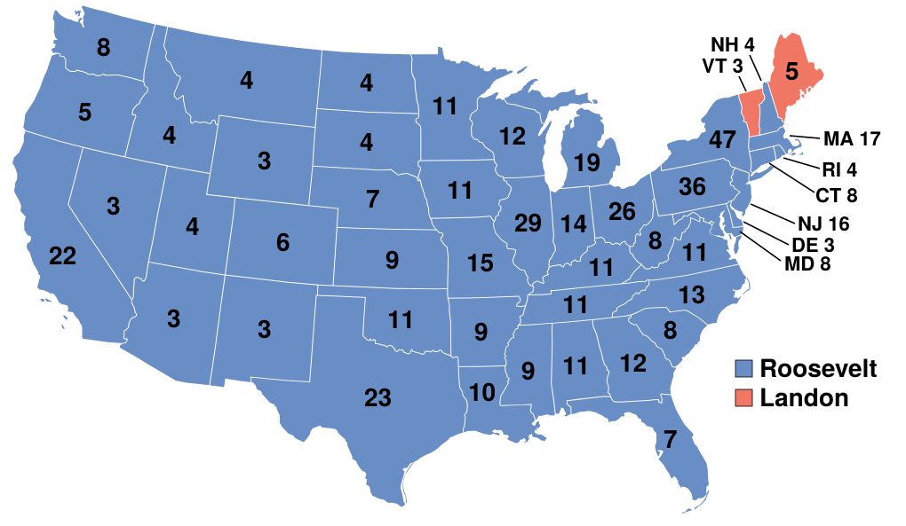
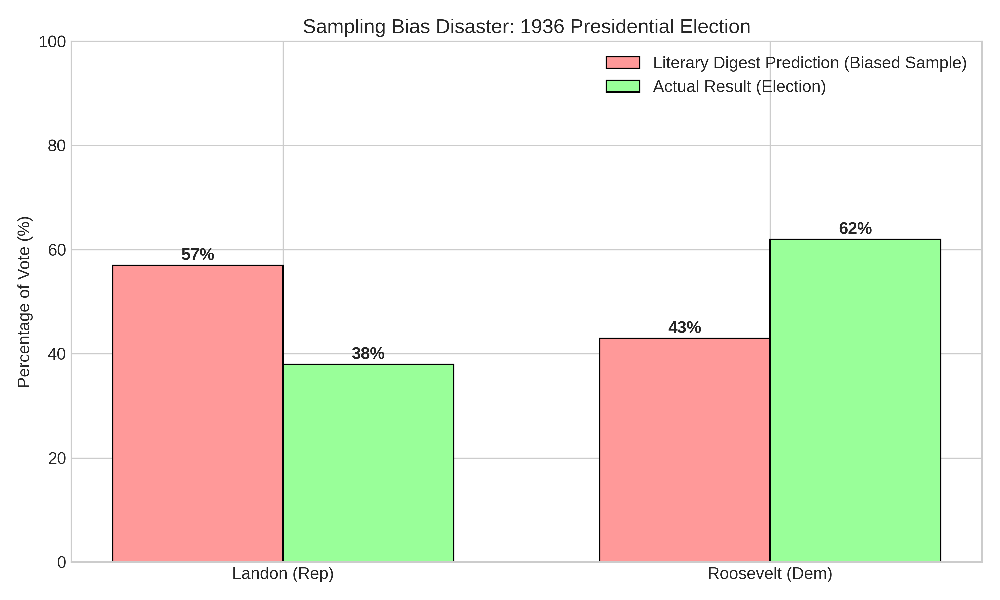

Trong Thế chiến II, quân đội Mỹ thống kê vị trí lỗ đạn trên những chiếc máy bay chiến đấu trở về căn cứ và định bọc thêm giáp thép vào đúng những chỗ chi chít lỗ đạn nhất (cánh và thân giữa). Nhà thống kê Abraham Wald lập tức ngăn lại: *"Các anh đang nhìn nhầm mẫu dữ liệu! Những chiếc máy bay bị trúng đạn vào động cơ và buồng lái đã rơi ngoài biển và không bao giờ bay về để các anh đếm!"* Hãy bọc giáp vào đúng những chỗ **không có lỗ đạn** trên các máy bay sống sót!

Câu chuyện kinh điển về thiên lệch sống sót ấy cho thấy **xác suất** không chỉ là chuyện tung đồng xu hay rút bài tây. Đó là bộ khung toán học kỷ luật để đo lường sự bất định, tránh những cạm bẫy trực giác nguy hiểm, và cập nhật niềm tin một cách chính xác mỗi khi có bằng chứng mới (Định lý Bayes).

---

## Kiến thức cần nhớ: Lý thuyết xác suất cơ bản đứng trên những trụ cột nào?

Ở bậc đại học, xác suất hiện đại (theo hệ tiên đề Kolmogorov) được dựng trên **bốn viên gạch cốt lõi**:

1. **Không gian mẫu $$\Omega$$ & Hệ tiên đề Kolmogorov:** Mọi phép thử ngẫu nhiên gắn với tập mọi kết quả có thể $$\Omega$$ và độ đo xác suất thỏa $$P(A) \ge 0$$, $$P(\Omega)=1$$ và tính cộng cho các biến cố xung khắc.
2. **Xác suất có điều kiện $$P(A\mid B)$$:** Khi biết biến cố $$B$$ đã xảy ra, toàn bộ vũ trụ thu hẹp lại từ $$\Omega$$ về đúng $$B$$ — mọi tỷ lệ xác suất phải được chia lại cho $$P(B)$$.
3. **Định lý Bayes:** Công thức "lật ngược điều kiện" từ $$P(\text{Bằng chứng}\mid \text{Giả thuyết})$$ sang $$P(\text{Giả thuyết}\mid \text{Bằng chứng})$$, là xương sống của chẩn đoán y khoa, lọc thư rác và học máy Bayes.
4. **Độc lập vs. Xung khắc:** Hai khái niệm cực dễ bị nhầm lẫn — xung khắc nghĩa là *không thể cùng xảy ra* ($$A\cap B = \emptyset$$), còn độc lập nghĩa là *biết $$B$$ xảy ra không làm đổi xác suất của $$A$$* ($$P(A\cap B) = P(A)P(B)$$).

---

## Không gian mẫu và biến cố

**Không gian mẫu (Sample Space)** $$\Omega$$ là tập hợp tất cả các kết quả có thể xảy ra của một phép thử ngẫu nhiên.

**Biến cố (Event)** $$A$$ là một tập con của không gian mẫu, $$A \subseteq \Omega$$.

### Ví dụ cơ bản

**Phép thử 1: Tung đồng xu**
- $$\Omega = \{\text{Ngửa}, \text{Sấp}\}$$
- Biến cố "Ra mặt ngửa": $$A = \{\text{Ngửa}\}$$

**Phép thử 2: Gieo xúc xắc**
- $$\Omega = \{1, 2, 3, 4, 5, 6\}$$
- Biến cố "Ra số chẵn": $$A = \{2, 4, 6\}$$
- Biến cố "Ra số lớn hơn 4": $$B = \{5, 6\}$$

```python
import numpy as np
import matplotlib.pyplot as plt
from collections import Counter

def simulate_dice_roll(n_rolls=10000):
    """
    Mô phỏng gieo xúc xắc và tính tần suất các biến cố
    """
    # Mô phỏng gieo xúc xắc
    rolls = np.random.randint(1, 7, size=n_rolls)
    
    # Đếm tần suất
    counts = Counter(rolls)
    
    # Tính xác suất thực nghiệm
    prob_even = np.sum(rolls % 2 == 0) / n_rolls
    prob_greater_than_4 = np.sum(rolls > 4) / n_rolls
    
    # Vẽ biểu đồ
    fig, axes = plt.subplots(1, 2, figsize=(14, 5))
    
    # Histogram các mặt xúc xắc
    faces = list(range(1, 7))
    frequencies = [counts[i] / n_rolls for i in faces]
    axes[0].bar(faces, frequencies, alpha=0.7, color='steelblue')
    axes[0].axhline(1/6, color='red', linestyle='--', linewidth=2, label='Xác suất lý thuyết (1/6)')
    axes[0].set_xlabel('Mặt xúc xắc')
    axes[0].set_ylabel('Tần suất')
    axes[0].set_title(f'Phân Phối Tần Suất ({n_rolls:,} lần gieo)')
    axes[0].legend()
    axes[0].grid(True, alpha=0.3, axis='y')
    
    # So sánh xác suất lý thuyết và thực nghiệm
    events = ['Số chẵn', 'Số > 4']
    theoretical = [3/6, 2/6]
    empirical = [prob_even, prob_greater_than_4]
    
    x = np.arange(len(events))
    width = 0.35
    axes[1].bar(x - width/2, theoretical, width, label='Lý thuyết', alpha=0.8)
    axes[1].bar(x + width/2, empirical, width, label='Thực nghiệm', alpha=0.8)
    axes[1].set_ylabel('Xác suất')
    axes[1].set_title('So Sánh Xác Suất Lý Thuyết vs Thực Nghiệm')
    axes[1].set_xticks(x)
    axes[1].set_xticklabels(events)
    axes[1].legend()
    axes[1].grid(True, alpha=0.3, axis='y')
    
    plt.tight_layout()
    # plt.show()
    
    print(f"Kết quả sau {n_rolls:,} lần gieo:")
    print(f"  P(Số chẵn) = {prob_even:.4f} (lý thuyết: 0.5000)")
    print(f"  P(Số > 4) = {prob_greater_than_4:.4f} (lý thuyết: {2/6:.4f})")

# simulate_dice_roll(10000)
```

## Định nghĩa xác suất

Có ba cách tiếp cận chính để định nghĩa xác suất:

### 1. Xác suất cổ điển (Classical Probability)

Khi mọi kết quả sơ cấp trong không gian mẫu hữu hạn đều đồng khả năng:

$$P(A) = \frac{\text{Số kết quả thuận lợi cho } A}{\text{Tổng số kết quả có thể}}$$

**Ví dụ:** Xác suất gieo xúc xắc ra số chẵn bằng $$\frac{3}{6} = \frac{1}{2}$$.

### 2. Xác suất tần suất (Frequentist Probability)

$$P(A) = \lim_{n \to \infty} \frac{\text{Số lần } A \text{ xảy ra}}{n}$$

Theo cách tiếp cận thực nghiệm này, xác suất là giới hạn của tần suất xuất hiện biến cố khi số lần lặp phép thử tiến tới vô cùng.

### 3. Xác suất tiên đề (Axiomatic Probability — Kolmogorov)

Xác suất là một hàm $$P: \mathcal{F} \to [0, 1]$$ thỏa mãn ba tiên đề (tính không âm, tính chuẩn hóa và tính cộng tính):

1. **Tính không âm (Non-negativity):** $$P(A) \geq 0$$ với mọi biến cố $$A$$.
2. **Tính chuẩn hóa (Normalization):** $$P(\Omega) = 1$$.
3. **Tính cộng tính (Additivity):** Nếu $$A$$ và $$B$$ xung khắc (rời nhau), thì $$P(A \cup B) = P(A) + P(B)$$ (tổng quát hơn là cộng tính đếm được đối với một dãy biến cố đôi một rời nhau).

## Cạm bẫy trong xác suất: Chọn mẫu thiên kiến (Sampling Bias)

> *"The sample with the built-in bias."* - Darrell Huff, *How to Lie with Statistics*

Khi ước lượng xác suất từ dữ liệu thực tế theo hướng tần suất, điều kiện bắt buộc là mẫu phải đại diện cho tổng thể (**representative**). Nếu quy trình chọn mẫu bị thiên kiến, ước lượng thu được sẽ sai lệch bất kể cỡ mẫu lớn đến đâu.

### Ví dụ kinh điển: Landon và Roosevelt (1936)

Năm 1936, tạp chí *Literary Digest* gửi 10 triệu phiếu thăm dò qua đường bưu điện để dự đoán kết quả bầu cử tổng thống Mỹ và thu về 2,4 triệu phản hồi — một cỡ mẫu rất lớn.

* **Dự đoán của Literary Digest:** Landon thắng áp đảo Roosevelt (57% so với 43%).
* **Kết quả thực tế:** Roosevelt thắng áp đảo (62% so với 38%).

**Nguyên nhân sai lệch:** Tạp chí lấy danh sách địa chỉ từ danh bạ điện thoại và hồ sơ đăng ký ô tô. Giữa thời kỳ Đại Suy Thoái năm 1936, chủ yếu tầng lớp khá giả mới sở hữu điện thoại và ô tô. Do đó, dù rất lớn, mẫu khảo sát chỉ đại diện cho nhóm cử tri giàu (vốn có xu hướng ủng hộ Landon) và bỏ qua phần đông cử tri thu nhập thấp (đa số ủng hộ Roosevelt).

**Bài học:** *Một mẫu lớn nhưng thiên kiến còn tệ hơn một mẫu nhỏ nhưng ngẫu nhiên (A large biased sample is worse than a small random sample).*


*Bản đồ kết quả bầu cử 1936: Roosevelt (xanh) thắng áp đảo Landon (đỏ), trái ngược với dự đoán của Literary Digest.*


*So sánh dự đoán của Literary Digest và kết quả bầu cử thực tế.*

```python
def sampling_bias_demo():
    """
    Minh họa Sampling Bias sinh ra kết quả sai lệch như thế nào
    """
    # Tổng thể: 1 triệu dân, 60% ủng hộ A (Thắng), 40% ủng hộ B (Thua)
    population_size = 1000000
    true_proportion = 0.60
    
    # Tạo đặc điểm: 'Giàu' có xu hướng ủng hộ B nhiều hơn
    # Giả sử 20% dân số là Giàu, 80% là Nghèo
    # Người Giàu: 30% ủng hộ A, 70% ủng hộ B
    # Người Nghèo: 67.5% ủng hộ A, 32.5% ủng hộ B (để average ra 60% tổng thể)
    
    status = np.random.choice(['Rich', 'Poor'], size=population_size, p=[0.2, 0.8])
    vote = np.zeros(population_size, dtype=int) # 1=Vote A, 0=Vote B
    
    # Gán vote dựa trên status
    rich_indices = np.where(status == 'Rich')[0]
    poor_indices = np.where(status == 'Poor')[0]
    
    vote[rich_indices] = np.random.choice([1, 0], size=len(rich_indices), p=[0.3, 0.7])
    vote[poor_indices] = np.random.choice([1, 0], size=len(poor_indices), p=[0.675, 0.325])
    
    print("Tổng thể (Sự thật):")
    print(f"  Ủng hộ A: {vote.mean()*100:.1f}% (A Thắng)")
    print("-" * 30)
    
    # 1. Random Sample (Mẫu ngẫu nhiên chuẩn) - n=1000
    random_indices = np.random.choice(np.arange(population_size), size=1000, replace=False)
    random_sample = vote[random_indices]
    print(f"Random Sample (n=1000):")
    print(f"  Ủng hộ A: {random_sample.mean()*100:.1f}% (Dự đoán đúng)")
    
    # 2. Biased Sample (Giống Literary Digest) - n=2.4 triệu (ở đây mô phỏng 10,000)
    # Xác suất người Giàu trả lời cao gấp 10 lần người Nghèo (do có đt/ô tô)
    probs = np.where(status == 'Rich', 0.1, 0.01)
    probs = probs / probs.sum()
    
    biased_indices = np.random.choice(np.arange(population_size), size=10000, replace=False, p=probs)
    biased_sample = vote[biased_indices]
    
    print("-" * 30)
    print(f"Biased Sample (n=10,000 - Người giàu dễ được chọn hơn):")
    print(f"  Ủng hộ A: {biased_sample.mean()*100:.1f}% (Dự đoán SAI: B Thắng!)")
    print(f"  -> Mẫu lớn gấp 10 lần nhưng vẫn sai vì bias.")

# sampling_bias_demo()
```

## Các quy tắc xác suất cơ bản

### Quy tắc cộng (Addition Rule)

Với hai biến cố bất kỳ $$A$$ và $$B$$:

$$P(A \cup B) = P(A) + P(B) - P(A \cap B)$$

Nếu $$A$$ và $$B$$ xung khắc (mutually exclusive), tức $$P(A \cap B) = 0$$, thì:

$$P(A \cup B) = P(A) + P(B)$$

```python
def visualize_addition_rule():
    """
    Minh họa quy tắc cộng bằng biểu đồ Venn
    """
    from matplotlib_venn import venn2
    
    fig, axes = plt.subplots(1, 2, figsize=(14, 5))
    
    # Trường hợp 1: Hai biến cố có giao
    axes[0].set_title('Hai Biến Cố Có Giao\nP(A∪B) = P(A) + P(B) - P(A∩B)', fontsize=12)
    v1 = venn2(subsets=(0.3, 0.4, 0.2), set_labels=('A', 'B'), ax=axes[0])
    v1.get_label_by_id('10').set_text('P(A\\B)\n= 0.3')
    v1.get_label_by_id('01').set_text('P(B\\A)\n= 0.4')
    v1.get_label_by_id('11').set_text('P(A∩B)\n= 0.2')
    
    # Trường hợp 2: Hai biến cố rời nhau
    axes[1].set_title('Hai Biến Cố Rời Nhau\nP(A∪B) = P(A) + P(B)', fontsize=12)
    v2 = venn2(subsets=(0.3, 0.4, 0), set_labels=('A', 'B'), ax=axes[1])
    v2.get_label_by_id('10').set_text('P(A)\n= 0.3')
    v2.get_label_by_id('01').set_text('P(B)\n= 0.4')
    
    plt.tight_layout()
    # plt.show()

# visualize_addition_rule()
```

### Quy tắc nhân (Multiplication Rule)

Với hai biến cố bất kỳ $$A$$ và $$B$$:

$$P(A \cap B) = P(A) \cdot P(B|A) = P(B) \cdot P(A|B)$$

Nếu $$A$$ và $$B$$ độc lập (independent), công thức rút gọn thành:

$$P(A \cap B) = P(A) \cdot P(B)$$

### Biến cố bù (Complement)

$$P(A^c) = 1 - P(A)$$

Công thức phần bù đặc biệt hữu ích khi việc tính trực tiếp xác suất của biến cố đối dễ hơn nhiều so với biến cố gốc.

```python
def birthday_problem_complement():
    """
    Sử dụng biến cố bù để giải bài toán sinh nhật
    """
    def prob_no_match_theoretical(n):
        """Tính xác suất KHÔNG có ai trùng sinh nhật (lý thuyết)"""
        if n > 365:
            return 0
        prob = 1
        for i in range(n):
            prob *= (365 - i) / 365
        return prob
    
    def prob_match_simulation(n, n_sims=10000):
        """Mô phỏng xác suất CÓ ít nhất 2 người trùng sinh nhật"""
        matches = 0
        for _ in range(n_sims):
            birthdays = np.random.randint(1, 366, size=n)
            if len(np.unique(birthdays)) < n:
                matches += 1
        return matches / n_sims
    
    # Thử với các nhóm khác nhau
    group_sizes = range(5, 51, 5)
    prob_theoretical = []
    prob_simulation = []
    
    for n in group_sizes:
        # Xác suất có trùng = 1 - xác suất không trùng
        prob_theoretical.append(1 - prob_no_match_theoretical(n))
        prob_simulation.append(prob_match_simulation(n, n_sims=5000))
    
    # Vẽ biểu đồ
    plt.figure(figsize=(12, 6))
    plt.plot(group_sizes, prob_theoretical, 'o-', linewidth=2, markersize=8, 
             label='Lý thuyết (dùng biến cố bù)', color='steelblue')
    plt.plot(group_sizes, prob_simulation, 's--', linewidth=2, markersize=6,
             label='Mô phỏng', alpha=0.7, color='orange')
    plt.axhline(0.5, color='red', linestyle='--', alpha=0.5, label='50%')
    plt.xlabel('Số người trong nhóm')
    plt.ylabel('Xác suất có ít nhất 2 người trùng sinh nhật')
    plt.title('Bài Toán Sinh Nhật: Sức Mạnh của Biến Cố Bù')
    plt.legend()
    plt.grid(True, alpha=0.3)
    # plt.show()
    
    # Tìm số người cần thiết để xác suất > 50%
    for i, n in enumerate(group_sizes):
        if prob_theoretical[i] > 0.5:
            print(f"Cần ít nhất {n} người để xác suất trùng sinh nhật > 50%")
            print(f"  Xác suất lý thuyết: {prob_theoretical[i]:.4f}")
            print(f"  Xác suất mô phỏng: {prob_simulation[i]:.4f}")
            break

# birthday_problem_complement()
```

## Xác suất có điều kiện (Conditional Probability)

<div class="textbook-definition" markdown="1">
**Định nghĩa:** Xác suất xảy ra của biến cố $$A$$ khi biết biến cố $$B$$ đã xảy ra:

$$P(A|B) = \frac{P(A \cap B)}{P(B)}, \quad P(B) > 0$$
</div>

**Ý nghĩa:** Khi đã biết $$B$$ xảy ra, không gian mẫu thu hẹp lại chỉ còn tập $$B$$, và ta tính tỷ lệ phần $$A$$ nằm trong không gian thu hẹp đó.

### Ví dụ: Bài toán xét nghiệm bệnh hiếm

Giả sử:
- 1% dân số mắc bệnh X.
- Xét nghiệm cho kết quả dương tính ở 99% người mắc bệnh (độ nhạy — sensitivity).
- Xét nghiệm cho kết quả dương tính giả ở 5% người khỏe mạnh (false positive rate).

**Câu hỏi:** Nếu một người có kết quả xét nghiệm dương tính, xác suất người đó thực sự mắc bệnh là bao nhiêu?

```python
def rare_disease_simulation(n_population=100000):
    """
    Mô phỏng bài toán test bệnh hiếm
    """
    # Tạo dân số
    has_disease = np.random.rand(n_population) < 0.01  # 1% mắc bệnh
    
    # Thực hiện test
    test_positive = np.zeros(n_population, dtype=bool)
    
    # Người bệnh: 99% test dương tính
    test_positive[has_disease] = np.random.rand(has_disease.sum()) < 0.99
    
    # Người khỏe: 5% test dương tính (false positive)
    test_positive[~has_disease] = np.random.rand((~has_disease).sum()) < 0.05
    
    # Tính xác suất có điều kiện
    n_positive = test_positive.sum()
    n_positive_and_disease = (test_positive & has_disease).sum()
    
    prob_disease_given_positive = n_positive_and_disease / n_positive
    
    # Tính theo công thức (sẽ học ở phần Bayes)
    # P(D|+) = P(+|D) * P(D) / P(+)
    # P(+) = P(+|D)*P(D) + P(+|~D)*P(~D)
    p_d = 0.01
    p_pos_given_d = 0.99
    p_pos_given_not_d = 0.05
    p_pos = p_pos_given_d * p_d + p_pos_given_not_d * (1 - p_d)
    prob_theoretical = (p_pos_given_d * p_d) / p_pos
    
    print("Bài Toán Test Bệnh Hiếm:")
    print("=" * 50)
    print(f"Tổng số người: {n_population:,}")
    print(f"Số người mắc bệnh: {has_disease.sum():,} ({has_disease.sum()/n_population*100:.2f}%)")
    print(f"Số người test dương tính: {n_positive:,}")
    print(f"Số người test dương tính VÀ mắc bệnh: {n_positive_and_disease:,}")
    print()
    print(f"P(Bệnh | Test +) mô phỏng: {prob_disease_given_positive:.4f}")
    print(f"P(Bệnh | Test +) lý thuyết: {prob_theoretical:.4f}")
    print()
    print("⚠️  Mặc dù test có độ chính xác 99%, nhưng nếu test dương tính,")
    print(f"    xác suất thực sự mắc bệnh chỉ khoảng {prob_theoretical*100:.1f}%!")
    print("    Lý do: Bệnh quá hiếm, nên có nhiều false positives.")

# rare_disease_simulation(100000)
```

## Định lý Bayes

Định lý Bayes cho phép cập nhật xác suất của một giả thuyết khi có thêm bằng chứng quan sát được:

$$P(A|B) = \frac{P(B|A) \cdot P(A)}{P(B)}$$

Ở dạng khai triển đầy đủ theo công thức xác suất toàn phần:

$$P(A|B) = \frac{P(B|A) \cdot P(A)}{P(B|A) \cdot P(A) + P(B|A^c) \cdot P(A^c)}$$

**Các thuật ngữ chính:**
- $$P(A)$$: **Xác suất tiên nghiệm (Prior probability)** — xác suất ban đầu trước khi quan sát $$B$$.
- $$P(B|A)$$: **Hàm hợp lý (Likelihood)** — xác suất quan sát được $$B$$ khi $$A$$ xảy ra.
- $$P(A|B)$$: **Xác suất hậu nghiệm (Posterior probability)** — xác suất của $$A$$ sau khi đã quan sát $$B$$.

### Ví dụ: Bộ lọc thư rác (Spam Filter)

```python
def naive_bayes_spam_filter():
    """
    Minh họa Naive Bayes cho spam classification
    """
    # Dữ liệu giả định
    # P(Spam) = 0.3
    # P("free" | Spam) = 0.8
    # P("free" | Ham) = 0.1
    
    p_spam = 0.3
    p_ham = 0.7
    p_free_given_spam = 0.8
    p_free_given_ham = 0.1
    
    # Tính P(Spam | "free") bằng Bayes
    p_free = p_free_given_spam * p_spam + p_free_given_ham * p_ham
    p_spam_given_free = (p_free_given_spam * p_spam) / p_free
    
    print("Spam Filter với Định Lý Bayes:")
    print("=" * 50)
    print(f"Prior: P(Spam) = {p_spam:.2f}")
    print(f"Likelihood: P('free' | Spam) = {p_free_given_spam:.2f}")
    print(f"Likelihood: P('free' | Ham) = {p_free_given_ham:.2f}")
    print()
    print(f"Posterior: P(Spam | 'free') = {p_spam_given_free:.4f}")
    print()
    print(f"Kết luận: Nếu email chứa từ 'free', xác suất là spam: {p_spam_given_free*100:.1f}%")
    
    # Visualize
    categories = ['Prior\nP(Spam)', 'Posterior\nP(Spam|"free")']
    probabilities = [p_spam, p_spam_given_free]
    
    plt.figure(figsize=(10, 6))
    bars = plt.bar(categories, probabilities, color=['steelblue', 'coral'], alpha=0.8)
    plt.ylabel('Xác suất')
    plt.title('Định Lý Bayes: Cập Nhật Niềm Tin Sau Khi Quan Sát Dữ Liệu')
    plt.ylim(0, 1)
    
    # Thêm giá trị lên cột
    for bar, prob in zip(bars, probabilities):
        height = bar.get_height()
        plt.text(bar.get_x() + bar.get_width()/2., height,
                f'{prob:.3f}',
                ha='center', va='bottom', fontsize=14, fontweight='bold')
    
    plt.grid(True, alpha=0.3, axis='y')
    # plt.show()

# naive_bayes_spam_filter()
```

## Tính độc lập (Independence)

Hai biến cố $$A$$ và $$B$$ được gọi là **độc lập** nếu:

$$P(A \cap B) = P(A) \cdot P(B)$$

Khi $$P(A) > 0$$ và $$P(B) > 0$$, điều kiện này tương đương với:

$$P(A|B) = P(A) \quad \text{và} \quad P(B|A) = P(B)$$

**Ý nghĩa:** Việc biết biến cố $$B$$ xảy ra không làm thay đổi xác suất xảy ra của biến cố $$A$$.

```python
def test_independence():
    """
    Kiểm tra tính độc lập bằng mô phỏng
    """
    n_trials = 100000
    
    # Thí nghiệm 1: Tung 2 đồng xu (độc lập)
    coin1 = np.random.randint(0, 2, n_trials)  # 0=Sấp, 1=Ngửa
    coin2 = np.random.randint(0, 2, n_trials)
    
    p_coin1_heads = (coin1 == 1).mean()
    p_coin2_heads = (coin2 == 1).mean()
    p_both_heads = ((coin1 == 1) & (coin2 == 1)).mean()
    
    print("Thí nghiệm 1: Tung 2 đồng xu (Độc lập)")
    print("=" * 50)
    print(f"P(Coin1 = Ngửa) = {p_coin1_heads:.4f}")
    print(f"P(Coin2 = Ngửa) = {p_coin2_heads:.4f}")
    print(f"P(Cả 2 đều Ngửa) = {p_both_heads:.4f}")
    print(f"P(Coin1) × P(Coin2) = {p_coin1_heads * p_coin2_heads:.4f}")
    print(f"Độc lập? {abs(p_both_heads - p_coin1_heads * p_coin2_heads) < 0.01}")
    print()
    
    # Thí nghiệm 2: Rút bài từ bộ bài (không độc lập nếu không hoàn lại)
    # Đơn giản hóa: 26 lá đỏ, 26 lá đen
    deck = np.array([0]*26 + [1]*26)  # 0=Đen, 1=Đỏ
    
    first_red = []
    second_red = []
    both_red = []
    
    for _ in range(n_trials):
        np.random.shuffle(deck)
        first = deck[0]
        second = deck[1]
        first_red.append(first == 1)
        second_red.append(second == 1)
        both_red.append((first == 1) and (second == 1))
    
    p_first_red = np.mean(first_red)
    p_second_red = np.mean(second_red)
    p_both_red = np.mean(both_red)
    
    print("Thí nghiệm 2: Rút 2 lá bài không hoàn lại (Phụ thuộc)")
    print("=" * 50)
    print(f"P(Lá 1 = Đỏ) = {p_first_red:.4f}")
    print(f"P(Lá 2 = Đỏ) = {p_second_red:.4f}")
    print(f"P(Cả 2 đều Đỏ) = {p_both_red:.4f}")
    print(f"P(Lá 1) × P(Lá 2) = {p_first_red * p_second_red:.4f}")
    print(f"Độc lập? {abs(p_both_red - p_first_red * p_second_red) < 0.01}")
    print()
    print(f"Lý thuyết: P(Cả 2 đỏ) = (26/52) × (25/51) = {(26/52)*(25/51):.4f}")

# test_independence()
```

### Giải thích: tự tay kiểm tra Định lý Bayes và phân biệt Độc lập với Xung khắc

Hãy cầm bút kiểm chứng hai tình huống cốt lõi nhất của xác suất cơ bản:

1. **Lọc thư rác bằng Định lý Bayes:** Giả sử $$20\%$$ email đến hộp thư là thư rác ($$P(S)=0.2,\ P(\neg S)=0.8$$). Cụm từ `"miễn phí"` xuất hiện trong $$80\%$$ thư rác ($$P(F\mid S)=0.8$$) nhưng chỉ xuất hiện trong $$5\%$$ thư thường ($$P(F\mid \neg S)=0.05$$). Khi nhận được một email có chữ `"miễn phí"`, xác suất đó là thư rác là bao nhiêu?
   - Xác suất toàn phần gặp từ `"miễn phí"`:
     $$P(F) = P(F\mid S)P(S) + P(F\mid \neg S)P(\neg S) = (0.8)(0.2) + (0.05)(0.8) = 0.16 + 0.04 = 0.20.$$
   - Lật ngược bằng Định lý Bayes:
     $$P(S\mid F) = \frac{0.16}{0.20} = 0.80 = 80\%!$$
   Chỉ một bằng chứng duy nhất đã đẩy niềm tin từ tiên nghiệm $$20\%$$ lên hậu nghiệm $$80\%$$.

2. **Tại sao hai biến cố xung khắc (có xác suất dương) KHÔNG BAO GIỜ độc lập?**
   Tung 1 viên xúc xắc cân đối $$\Omega = \{1, 2, 3, 4, 5, 6\}$$:
   - Xét $$A = \{2, 4, 6\}$$ (số chẵn, $$P(A) = 1/2$$) và $$B = \{1, 2\}$$ ($$P(B) = 1/3$$):
     Giao $$A \cap B = \{2\}$$ có $$P(A\cap B) = \frac{1}{6} = \frac{1}{2}\cdot\frac{1}{3} = P(A)P(B)$$ → **$$A$$ và $$B$$ ĐỘC LẬP** (dù chúng vẫn giao nhau tại mặt 2!).
   - Xét $$A = \{2, 4, 6\}$$ và $$C = \{1, 3, 5\}$$ (số lẻ, $$P(C) = 1/2$$):
     Giao $$A \cap C = \emptyset \Rightarrow P(A\cap C) = 0 \neq \frac{1}{4} = P(A)P(C)$$ → **$$A$$ và $$C$$ XUNG KHẮC nên PHỤ THUỘC TUYỆT ĐỐI** (biết ra chẵn lập tức loại sạch khả năng ra lẻ!).

## Video tham khảo

- [Conditional Probabilities, Clearly Explained!!!](https://www.youtube.com/watch?v=_IgyaD7vOOA) — StatQuest with Josh Starmer, tiếng Anh. **Xem trước.** Giải thích xác suất có điều kiện từ bảng tần số, kết nối không gian mẫu với định lý Bayes.
- [Bayes theorem, the geometry of changing beliefs](https://www.youtube.com/watch?v=HZGCoVF3YvM) — 3Blue1Brown, tiếng Anh. Minh họa trực quan định lý Bayes như cách cập nhật xác suất khi có bằng chứng mới, khớp với công thức trong bài.
- [L03.5 Conditional Independence](https://www.youtube.com/watch?v=7B3cDe39lwY) — MIT OpenCourseWare, tiếng Anh. Phân biệt độc lập có điều kiện với độc lập thông thường trước khi áp dụng cho mô hình lọc thư rác Naive Bayes.

## Bài tập thực hành

**Bài 1: Bài toán Monty Hall**
Lập trình mô phỏng bài toán Monty Hall để tính xác suất thắng khi:
- Giữ nguyên lựa chọn ban đầu.
- Đổi sang cửa còn lại.

So sánh kết quả mô phỏng với xác suất lý thuyết (1/3 và 2/3).

**Bài 2: Định lý Bayes trong y học**
Một căn bệnh có tỷ lệ mắc trong dân số là 0,5%. Xét nghiệm chẩn đoán có độ nhạy (sensitivity) 95% và độ đặc hiệu (specificity) 90%.
- Tính xác suất P(Bệnh | Dương tính).
- Tính xác suất P(Khỏe | Âm tính).
- Mô phỏng trên 1 triệu người để kiểm chứng kết quả lý thuyết.

**Bài 3: Kiểm tra tính độc lập**
Sinh dữ liệu cho hai trường hợp:
- Trường hợp 1: hai biến cố/biến X và Y độc lập.
- Trường hợp 2: Y = f(X) (phụ thuộc).

Dùng mô phỏng để kiểm tra xem đẳng thức $$P(X \cap Y) \approx P(X) \cdot P(Y)$$ có thỏa mãn trong từng trường hợp hay không.

**Bài 4: Nghịch lý Simpson (Simpson's Paradox)**
Tìm hiểu về nghịch lý Simpson và xây dựng một ví dụ mô phỏng minh họa hiện tượng này.

Bài tùy chọn tiếp theo, [03-02-00 Ứng dụng và phát triển gần đây](), kết nối xác suất có điều kiện, định lý Bayes và tính độc lập với hiệu chỉnh xác suất (calibration), mô hình ngôn ngữ lớn và đồ thị nhân quả (2021–2023).
