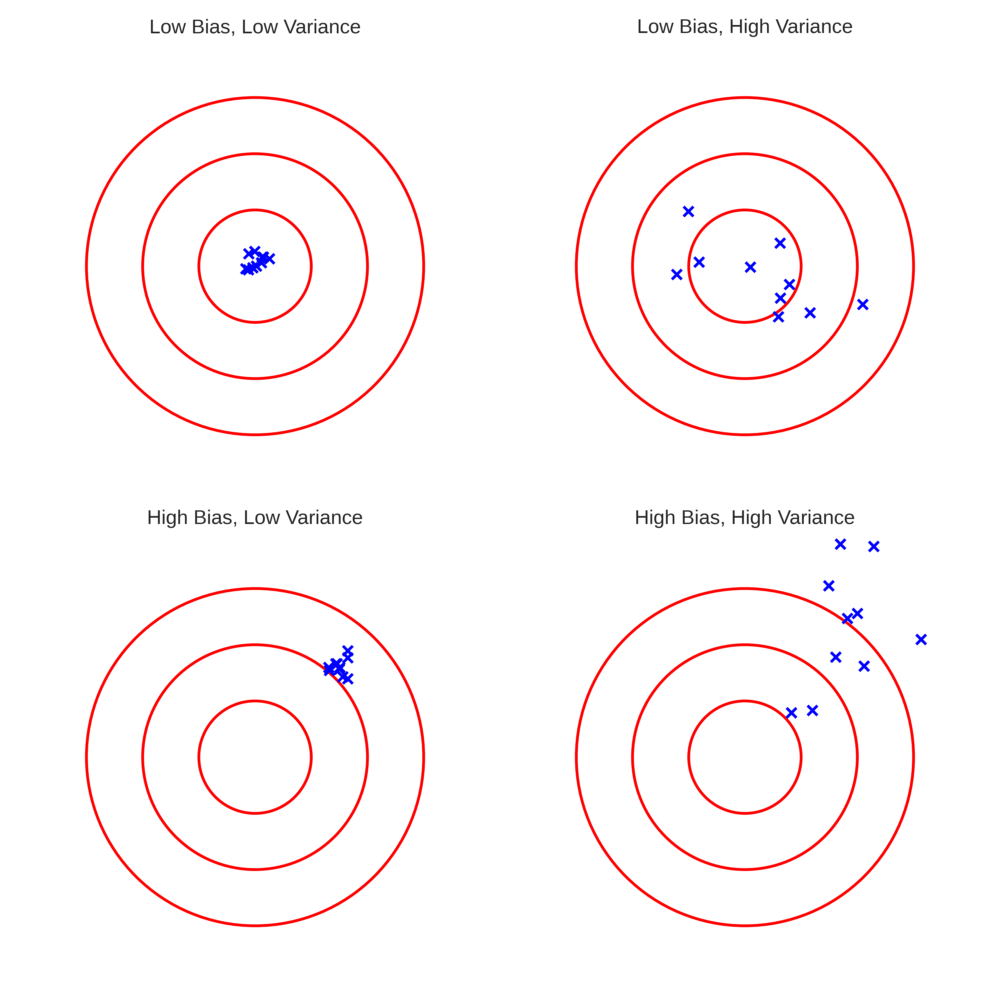

Trong Thế chiến II, tình báo quân Đồng minh đối mặt với một câu hỏi quan trọng: nhà máy Đức đang sản xuất tổng cộng bao nhiêu chiếc xe tăng mỗi tháng? Những nguồn tin gián điệp truyền thống ước tính con số khoảng 1.400 chiếc/tháng, nhưng một nhóm nhà thống kê lại chọn cách nhìn vào những chi tiết nhỏ bé hơn nhiều: **số sê-ri nối tiếp nhau** (1, 2, ..., $$N$$) khắc trên hộp số của những chiếc xe tăng bị thu giữ. Giả sử bạn chỉ bắt được 4 chiếc mang số sê-ri `19, 40, 42, 60`. Rõ ràng tổng số xe $$N$$ ít nhất phải là 60 — nhưng ước lượng $$\hat{N} = 60$$ (chính là MLE thô!) chắc chắn luôn đánh giá *thấp hơn* sự thật vì rất hiếm khi bạn bắt trúng chiếc xe cuối cùng vừa xuất xưởng. Chỉ cần cộng thêm khoảng trống trung bình ở đầu kia ($$\hat{N} = \max X_i + \frac{\max X_i}{n} - 1 \approx 74$$), các nhà thống kê đã ước lượng sản lượng thực là 246 chiếc/tháng — và hồ sơ Đức thu được sau chiến tranh ghi nhận con số thật là **245**!

Câu chuyện *German Tank Problem* đó là trái tim của **ước lượng điểm (point estimation)**: từ một mẫu dữ liệu hữu hạn đầy nhiễu, làm sao thiết kế một công thức (bộ ước lượng) vừa chính xác, vừa ổn định để đoán tham số ẩn của cả tổng thể? Bài học này dẫn bạn qua hai trụ cột chế tạo bộ ước lượng — **Ước lượng Hợp lý Cực đại (MLE)** và **Phương pháp Moment (MoM)** — cùng ba thước đo chất lượng kinh điển: độ chệch, phương sai và tính nhất quán.

---

## Kiến thức cần nhớ: Lý thuyết ước lượng điểm nghiên cứu điều gì?

Nếu xác suất đi theo chiều thuận — *biết tham số $$\theta$$ của mô hình, tính xác suất sinh ra dữ liệu $$X$$* — thì **thống kê suy diễn (statistical inference)** lật ngược mũi tên: *quan sát dữ liệu $$X$$, truy ngược lại tham số $$\theta$$*. Bốn trụ cột định hình toàn bộ ngành này:

1. **Phân phối lấy mẫu của bộ ước lượng:** Trước khi thu thập dữ liệu, công thức $$\hat{\theta} = g(X_1,\ldots,X_n)$$ là một **biến ngẫu nhiên**. Nếu lặp lại thí nghiệm hàng nghìn lần, $$\hat{\theta}$$ sẽ tạo thành một phân phối xung quanh giá trị thật $$\theta$$ — toàn bộ chất lượng của bộ ước lượng được đo qua hình dáng phân phối này.
2. **Đánh đổi Độ chệch – Phương sai (Bias–Variance Trade-off):** Sai số toàn phương trung bình phân tách chính xác thành $$\mathrm{MSE}(\hat{\theta}) = \mathrm{Bias}(\hat{\theta})^2 + \mathrm{Var}(\hat{\theta})$$. Một bộ ước lượng không chệch nhưng phương sai quá lớn đôi khi còn tệ hơn một bộ ước lượng hơi chệch nhưng cực kỳ ổn định (nền tảng của chính quy hóa Ridge/Lasso và Empirical Bayes).
3. **Ước lượng Hợp lý Cực đại (MLE):** Chọn $$\theta$$ làm cho xác suất (hoặc mật độ) quan sát thấy chính mẫu dữ liệu đang có đạt giá trị lớn nhất. Nhờ tính nhất quán và tiệm cận chuẩn hiệu quả (đạt cận dưới Cramér–Rao khi $$n$$ lớn), MLE trở thành xương sống của cả thống kê cổ điển lẫn hàm mất mát cross-entropy trong học sâu.
4. **Phương pháp Moment (MoM):** Khớp các moment lý thuyết ($$\mathbb{E}[X], \mathbb{E}[X^2],\ldots$$) với moment mẫu. Thường dễ tính dạng đóng hơn MLE và làm điểm khởi tạo tuyệt vời cho các thuật toán tối ưu lặp.

---

## Bộ Ước Lượng (Estimator) và Giá Trị Ước Lượng (Estimate)

**Bộ ước lượng (Estimator)** $$\hat{\theta}$$ là một hàm số của dữ liệu mẫu (nên bản thân nó là một biến ngẫu nhiên):

$$\hat{\theta} = g(X_1, X_2, \ldots, X_n)$$

**Giá trị ước lượng (Estimate)** là giá trị số cụ thể mà bộ ước lượng nhận được trên một mẫu quan sát cụ thể.

**Ví dụ:**
- Bộ ước lượng: $$\bar{X} = \frac{1}{n}\sum_{i=1}^n X_i$$ (trung bình mẫu).
- Giá trị ước lượng: Nếu mẫu dữ liệu là `[2, 4, 6]`, thì giá trị ước lượng bằng `4`.

```python
import numpy as np
import matplotlib.pyplot as plt
from scipy import stats
from scipy.optimize import minimize

def illustrate_estimator_vs_estimate():
    """
    Minh họa sự khác biệt giữa estimator và estimate
    """
    # True parameter
    true_mean = 10
    true_std = 2
    
    # Lấy nhiều mẫu khác nhau
    n_samples = 30
    n_experiments = 1000
    
    estimates = []
    for _ in range(n_experiments):
        sample = np.random.normal(true_mean, true_std, n_samples)
        estimate = sample.mean()  # Một estimate cụ thể
        estimates.append(estimate)
    
    estimates = np.array(estimates)
    
    # Visualize
    plt.figure(figsize=(12, 5))
    
    plt.subplot(1, 2, 1)
    plt.hist(estimates, bins=50, density=True, alpha=0.7, edgecolor='black')
    plt.axvline(true_mean, color='red', linestyle='--', linewidth=2, label=f'True μ = {true_mean}')
    plt.axvline(estimates.mean(), color='blue', linestyle='-', linewidth=2, 
                label=f'Mean of estimates = {estimates.mean():.2f}')
    plt.xlabel('Estimate value')
    plt.ylabel('Density')
    plt.title(f'Sampling Distribution of Estimator $\\bar{{X}}$\n({n_experiments} experiments, n={n_samples})')
    plt.legend()
    plt.grid(True, alpha=0.3)
    
    # Một mẫu cụ thể
    one_sample = np.random.normal(true_mean, true_std, n_samples)
    one_estimate = one_sample.mean()
    
    plt.subplot(1, 2, 2)
    plt.hist(one_sample, bins=15, alpha=0.7, edgecolor='black')
    plt.axvline(one_estimate, color='blue', linestyle='-', linewidth=2,
                label=f'Estimate = {one_estimate:.2f}')
    plt.axvline(true_mean, color='red', linestyle='--', linewidth=2,
                label=f'True μ = {true_mean}')
    plt.xlabel('Value')
    plt.ylabel('Frequency')
    plt.title('Một Mẫu Cụ Thể')
    plt.legend()
    plt.grid(True, alpha=0.3)
    
    plt.tight_layout()
    # plt.show()
    
    print("Estimator vs Estimate:")
    print("=" * 60)
    print(f"Estimator: $\\bar{{X}}$ = (1/n) Σ X_i")
    print(f"Một estimate cụ thể: {one_estimate:.4f}")
    print(f"Mean của {n_experiments} estimates: {estimates.mean():.4f}")
    print(f"True parameter: {true_mean}")

# illustrate_estimator_vs_estimate()
```

## Các Tính Chất Của Bộ Ước Lượng

### 1. Tính Không Chệch (Unbiasedness)

Bộ ước lượng $$\hat{\theta}$$ được gọi là không chệch (unbiased) nếu kỳ vọng của nó bằng đúng tham số thực:

$$E[\hat{\theta}] = \theta$$

**Ví dụ:**
- Trung bình mẫu $$\bar{X}$$ là bộ ước lượng không chệch của $$\mu$$.
- Phương sai mẫu hiệu chỉnh $$S^2 = \frac{1}{n-1}\sum(X_i - \bar{X})^2$$ là bộ ước lượng không chệch của $$\sigma^2$$.
- Ngược lại, $$\frac{1}{n}\sum(X_i - \bar{X})^2$$ là bộ ước lượng **bị chệch (biased)** (có xu hướng ước lượng thấp hơn $$\sigma^2$$).

```python
def demonstrate_bias():
    """
    Minh họa biased vs unbiased estimators
    """
    true_mean = 5
    true_var = 4
    n_samples = 10
    n_experiments = 10000
    
    # Hai estimators cho variance
    biased_estimates = []
    unbiased_estimates = []
    
    for _ in range(n_experiments):
        sample = np.random.normal(true_mean, np.sqrt(true_var), n_samples)
        sample_mean = sample.mean()
        
        # Biased: chia cho n
        biased_var = np.sum((sample - sample_mean)**2) / n_samples
        biased_estimates.append(biased_var)
        
        # Unbiased: chia cho n-1
        unbiased_var = np.sum((sample - sample_mean)**2) / (n_samples - 1)
        unbiased_estimates.append(unbiased_var)
    
    biased_estimates = np.array(biased_estimates)
    unbiased_estimates = np.array(unbiased_estimates)
    
    # Visualize
    plt.figure(figsize=(12, 5))
    
    plt.subplot(1, 2, 1)
    plt.hist(biased_estimates, bins=50, alpha=0.7, label='Biased (÷n)', edgecolor='black')
    plt.hist(unbiased_estimates, bins=50, alpha=0.7, label='Unbiased (÷(n-1))', edgecolor='black')
    plt.axvline(true_var, color='red', linestyle='--', linewidth=2, label=f'True σ² = {true_var}')
    plt.axvline(biased_estimates.mean(), color='blue', linestyle=':', linewidth=2)
    plt.axvline(unbiased_estimates.mean(), color='orange', linestyle=':', linewidth=2)
    plt.xlabel('Estimate')
    plt.ylabel('Frequency')
    plt.title('Biased vs Unbiased Estimators')
    plt.legend()
    plt.grid(True, alpha=0.3)
    
    plt.subplot(1, 2, 2)
    categories = ['Biased\n(÷n)', 'Unbiased\n(÷(n-1))']
    means = [biased_estimates.mean(), unbiased_estimates.mean()]
    bars = plt.bar(categories, means, alpha=0.7, edgecolor='black')
    plt.axhline(true_var, color='red', linestyle='--', linewidth=2, label=f'True σ² = {true_var}')
    plt.ylabel('Mean of Estimates')
    plt.title('Expected Value of Estimators')
    plt.legend()
    plt.grid(True, alpha=0.3, axis='y')
    
    # Thêm giá trị
    for bar, mean in zip(bars, means):
        height = bar.get_height()
        plt.text(bar.get_x() + bar.get_width()/2., height,
                f'{mean:.3f}',
                ha='center', va='bottom', fontsize=12)
    
    plt.tight_layout()
    # plt.show()
    
    print("Bias của Estimators:")
    print("=" * 60)
    print(f"True variance: {true_var}")
    print(f"Biased estimator (÷n):     E[S²] = {biased_estimates.mean():.4f}, Bias = {biased_estimates.mean() - true_var:.4f}")
    print(f"Unbiased estimator (÷n-1): E[S²] = {unbiased_estimates.mean():.4f}, Bias = {unbiased_estimates.mean() - true_var:.4f}")

# demonstrate_bias()
```

### 2. Tính Nhất Quán (Consistency)

Bộ ước lượng $$\hat{\theta}_n$$ được gọi là nhất quán (hay vững — consistent) nếu nó hội tụ theo xác suất về tham số thực khi cỡ mẫu tăng ra vô cùng:

$$\hat{\theta}_n \xrightarrow{P} \theta \quad \text{as } n \to \infty$$

**Ý nghĩa:** Khi thu thập ngày càng nhiều dữ liệu, giá trị ước lượng sẽ tiến càng sát về tham số thực của tổng thể.

### 3. Tính Hiệu Quả (Efficiency)

Trong lớp các bộ ước lượng không chệch, bộ ước lượng có phương sai $$\text{Var}(\hat{\theta})$$ nhỏ nhất được gọi là hiệu quả nhất.


*Minh họa độ chệch (Bias) và phương sai (Variance) qua hình ảnh bắn bia. Mục tiêu lý tưởng là "Low Bias, Low Variance" (góc trên bên trái).*

### Sự Đánh Đổi Giữa Độ Chệch và Phương Sai (Bias–Variance Trade-off)

Trong thống kê và học máy, sai số bình phương trung bình được phân tách thành $$\text{MSE} = \text{Bias}^2 + \text{Variance}$$. Thực tế thường tồn tại sự đánh đổi giữa hai thành phần này: giảm độ chệch có thể làm tăng phương sai và ngược lại.

## Ước Lượng Hợp Lý Cực Đại (Maximum Likelihood Estimation — MLE)

**Ý tưởng:** Chọn giá trị tham số sao cho xác suất (hoặc mật độ xác suất) quan sát được tập dữ liệu hiện có là lớn nhất.

**Hàm hợp lý (Likelihood function):**
$$L(\theta | x_1, \ldots, x_n) = \prod_{i=1}^n f(x_i | \theta)$$

**Hàm log-hợp lý (Log-likelihood):**
$$\ell(\theta) = \log L(\theta) = \sum_{i=1}^n \log f(x_i | \theta)$$

**Ước lượng MLE:**
$$\hat{\theta}_{MLE} = \arg\max_{\theta} \ell(\theta)$$

```python
def mle_normal_distribution():
    """
    MLE cho phân phối chuẩn
    """
    # Sinh dữ liệu
    true_mu, true_sigma = 5, 2
    n_samples = 100
    data = np.random.normal(true_mu, true_sigma, n_samples)
    
    # MLE bằng công thức
    mu_mle = data.mean()
    sigma_mle = np.sqrt(np.mean((data - mu_mle)**2))
    
    # Verify bằng optimization
    def neg_log_likelihood(params):
        mu, sigma = params
        if sigma <= 0:
            return np.inf
        return -np.sum(stats.norm.logpdf(data, mu, sigma))
    
    result = minimize(neg_log_likelihood, x0=[0, 1], method='Nelder-Mead')
    mu_mle_opt, sigma_mle_opt = result.x
    
    # Visualize likelihood surface
    mu_grid = np.linspace(3, 7, 100)
    sigma_grid = np.linspace(1, 3, 100)
    MU, SIGMA = np.meshgrid(mu_grid, sigma_grid)
    
    log_likelihood = np.zeros_like(MU)
    for i in range(len(mu_grid)):
        for j in range(len(sigma_grid)):
            log_likelihood[j, i] = np.sum(stats.norm.logpdf(data, MU[j, i], SIGMA[j, i]))
    
    # Plot
    fig = plt.figure(figsize=(14, 5))
    
    # Contour plot
    ax1 = fig.add_subplot(121)
    contour = ax1.contour(MU, SIGMA, log_likelihood, levels=20)
    ax1.clabel(contour, inline=True, fontsize=8)
    ax1.plot(mu_mle, sigma_mle, 'r*', markersize=20, label='MLE')
    ax1.plot(true_mu, true_sigma, 'go', markersize=10, label='True params')
    ax1.set_xlabel('μ')
    ax1.set_ylabel('σ')
    ax1.set_title('Log-Likelihood Surface')
    ax1.legend()
    ax1.grid(True, alpha=0.3)
    
    # Histogram với fitted distribution
    ax2 = fig.add_subplot(122)
    ax2.hist(data, bins=30, density=True, alpha=0.7, edgecolor='black', label='Data')
    
    x_plot = np.linspace(data.min(), data.max(), 1000)
    ax2.plot(x_plot, stats.norm.pdf(x_plot, mu_mle, sigma_mle), 'r-', 
             linewidth=2, label=f'MLE: N({mu_mle:.2f}, {sigma_mle:.2f}²)')
    ax2.plot(x_plot, stats.norm.pdf(x_plot, true_mu, true_sigma), 'g--',
             linewidth=2, label=f'True: N({true_mu}, {true_sigma}²)')
    ax2.set_xlabel('x')
    ax2.set_ylabel('Density')
    ax2.set_title('Data và Fitted Distribution')
    ax2.legend()
    ax2.grid(True, alpha=0.3)
    
    plt.tight_layout()
    # plt.show()
    
    print("Maximum Likelihood Estimation:")
    print("=" * 60)
    print(f"True parameters:    μ = {true_mu}, σ = {true_sigma}")
    print(f"MLE (formula):      μ = {mu_mle:.4f}, σ = {sigma_mle:.4f}")
    print(f"MLE (optimization): μ = {mu_mle_opt:.4f}, σ = {sigma_mle_opt:.4f}")

# mle_normal_distribution()
```

### MLE Cho Một Số Phân Phối Khác

```python
def mle_examples():
    """
    MLE cho các phân phối khác nhau
    """
    print("MLE cho Các Phân Phối:")
    print("=" * 60)
    
    # 1. Bernoulli/Binomial
    print("\n1. Bernoulli:")
    true_p = 0.7
    n_trials = 100
    data_bern = np.random.binomial(1, true_p, n_trials)
    p_mle = data_bern.mean()
    print(f"   True p = {true_p}")
    print(f"   MLE: p̂ = {p_mle:.4f} (= sample mean)")
    
    # 2. Poisson
    print("\n2. Poisson:")
    true_lambda = 5
    data_pois = np.random.poisson(true_lambda, 100)
    lambda_mle = data_pois.mean()
    print(f"   True λ = {true_lambda}")
    print(f"   MLE: λ̂ = {lambda_mle:.4f} (= sample mean)")
    
    # 3. Exponential
    print("\n3. Exponential:")
    true_rate = 2
    data_exp = np.random.exponential(1/true_rate, 100)
    rate_mle = 1 / data_exp.mean()
    print(f"   True λ = {true_rate}")
    print(f"   MLE: λ̂ = {rate_mle:.4f} (= 1/sample mean)")
    
    # 4. Uniform
    print("\n4. Uniform(0, θ):")
    true_theta = 10
    data_unif = np.random.uniform(0, true_theta, 100)
    theta_mle = data_unif.max()
    print(f"   True θ = {true_theta}")
    print(f"   MLE: θ̂ = {theta_mle:.4f} (= max(data))")
    print(f"   ⚠️  Lưu ý: MLE này là BIASED!")

# mle_examples()
```

## Phương Pháp Moment (Method of Moments)

**Ý tưởng:** Cân bằng các moment mẫu (sample moments) với các moment lý thuyết của tổng thể (population moments) rồi giải hệ phương trình để tìm tham số.

**Moment lý thuyết bậc $$k$$:** $$\mu_k = E[X^k]$$

**Moment mẫu bậc $$k$$:** $$m_k = \frac{1}{n}\sum_{i=1}^n X_i^k$$

**Phương pháp Moment:** Giải hệ phương trình $$\mu_k(\theta) = m_k$$.

```python
def method_of_moments_example():
    """
    So sánh MLE và Method of Moments
    """
    # Sinh dữ liệu từ Gamma(α=2, β=3)
    true_alpha, true_beta = 2, 3
    n_samples = 1000
    data = np.random.gamma(true_alpha, true_beta, n_samples)
    
    # Method of Moments
    # E[X] = αβ, Var(X) = αβ²
    # m1 = sample mean, m2 = sample variance
    m1 = data.mean()
    m2 = data.var()
    
    # Giải: αβ = m1, αβ² = m2
    # => β = m2/m1, α = m1/β = m1²/m2
    beta_mom = m2 / m1
    alpha_mom = m1 / beta_mom
    
    # MLE (dùng scipy)
    def neg_log_likelihood(params):
        alpha, beta = params
        if alpha <= 0 or beta <= 0:
            return np.inf
        return -np.sum(stats.gamma.logpdf(data, alpha, scale=beta))
    
    result = minimize(neg_log_likelihood, x0=[1, 1], method='Nelder-Mead')
    alpha_mle, beta_mle = result.x
    
    # Visualize
    plt.figure(figsize=(12, 5))
    
    plt.subplot(1, 2, 1)
    plt.hist(data, bins=50, density=True, alpha=0.7, edgecolor='black', label='Data')
    
    x_plot = np.linspace(0, data.max(), 1000)
    plt.plot(x_plot, stats.gamma.pdf(x_plot, true_alpha, scale=true_beta), 'g-',
             linewidth=2, label=f'True: Γ({true_alpha}, {true_beta})')
    plt.plot(x_plot, stats.gamma.pdf(x_plot, alpha_mom, scale=beta_mom), 'b--',
             linewidth=2, label=f'MoM: Γ({alpha_mom:.2f}, {beta_mom:.2f})')
    plt.plot(x_plot, stats.gamma.pdf(x_plot, alpha_mle, scale=beta_mle), 'r:',
             linewidth=2, label=f'MLE: Γ({alpha_mle:.2f}, {beta_mle:.2f})')
    plt.xlabel('x')
    plt.ylabel('Density')
    plt.title('Gamma Distribution: MoM vs MLE')
    plt.legend()
    plt.grid(True, alpha=0.3)
    
    # Comparison table
    ax = plt.subplot(1, 2, 2)
    ax.axis('tight')
    ax.axis('off')
    
    table_data = [
        ['Method', 'α', 'β'],
        ['True', f'{true_alpha:.4f}', f'{true_beta:.4f}'],
        ['MoM', f'{alpha_mom:.4f}', f'{beta_mom:.4f}'],
        ['MLE', f'{alpha_mle:.4f}', f'{beta_mle:.4f}']
    ]
    
    table = ax.table(cellText=table_data, cellLoc='center', loc='center',
                     colWidths=[0.3, 0.3, 0.3])
    table.auto_set_font_size(False)
    table.set_fontsize(12)
    table.scale(1, 2)
    
    # Color header
    for i in range(3):
        table[(0, i)].set_facecolor('#40466e')
        table[(0, i)].set_text_props(weight='bold', color='white')
    
    plt.tight_layout()
    # plt.show()
    
    print("Method of Moments vs MLE:")
    print("=" * 60)
    print(f"True:  α = {true_alpha}, β = {true_beta}")
    print(f"MoM:   α = {alpha_mom:.4f}, β = {beta_mom:.4f}")
    print(f"MLE:   α = {alpha_mle:.4f}, β = {beta_mle:.4f}")

# method_of_moments_example()
```

---

### Ví dụ tính tay làm từng bước: Tính MLE cho phân phối mũ và soi độ chệch của phương sai mẫu

Giả sử bạn đo thời gian chờ (tính bằng phút) giữa 5 cuộc gọi liên tiếp đến tổng đài và thu được mẫu số liệu nhỏ:

$$x = (2,\; 5,\; 3,\; 6,\; 4).$$

**Phần A — Tìm tốc độ cuộc gọi $$\lambda$$ bằng MLE (giả sử $$X_i \stackrel{\text{i.i.d.}}{\sim} \mathrm{Exp}(\lambda)$$):**
1. Hàm mật độ của một quan sát là $$f(x_i \mid \lambda) = \lambda e^{-\lambda x_i}$$. Hàm hợp lý của cả 5 quan sát:
   $$L(\lambda) = \prod_{i=1}^5 \lambda e^{-\lambda x_i} = \lambda^5 e^{-\lambda(2+5+3+6+4)} = \lambda^5 e^{-20\lambda}.$$
2. Lấy logarit tự nhiên để biến tích thành tổng (hàm log-likelihood):
   $$\ell(\lambda) = 5\ln\lambda - 20\lambda.$$
3. Đặt đạo hàm bằng 0:
   $$\ell'(\lambda) = \frac{5}{\lambda} - 20 = 0 \implies \hat{\lambda}_{\text{MLE}} = \frac{5}{20} = 0{,}25\text{ cuộc gọi/phút}.$$
   Kiểm tra đạo hàm cấp hai: $$\ell''(\lambda) = -5/\lambda^2 < 0$$, xác nhận đây là cực đại toàn cục!

**Phần B — Soi trực tiếp vì sao phương sai MLE bị chệch xuống trên cùng mẫu $$x = (2, 5, 3, 6, 4)$$:**
- Trung bình mẫu: $$\bar{x} = \frac{2+5+3+6+4}{5} = 4$$.
- Tổng bình phương độ lệch quanh $$\bar{x}$$:
  $$\sum_{i=1}^5 (x_i - \bar{x})^2 = (-2)^2 + 1^2 + (-1)^2 + 2^2 + 0^2 = 4 + 1 + 1 + 4 + 0 = 10.$$
- Nếu chia cho $$n = 5$$ (công thức MLE cho phân phối chuẩn): $$\hat{\sigma}^2_{\text{MLE}} = \frac{10}{5} = 2{,}0$$.
- Nếu chia cho $$n - 1 = 4$$ (hiệu chỉnh Bessel): $$s^2 = \frac{10}{4} = 2{,}5$$.

Tại sao chia cho 5 lại chệch xuống? Vì $$\bar{x}$$ được chọn để **cực tiểu hóa** tổng bình phương độ lệch của chính 5 điểm đó, nên $$\sum(x_i - \bar{x})^2$$ luôn nhỏ hơn $$\sum(x_i - \mu)^2$$ một lượng trung bình đúng bằng $$\sigma^2$$ (mất 1 bậc tự do). Do đó $$\mathbb{E}[\hat{\sigma}^2_{\text{MLE}}] = \frac{4}{5}\sigma^2$$ — thiếu hụt 20% khi $$n=5$$!

### Giải thích: Mạch suy luận khi thiết kế một bộ ước lượng

1. **Phân biệt rạch ròi bộ ước lượng (biến ngẫu nhiên) và giá trị ước lượng (con số cụ thể):** Khi nói "$$\bar{X}$$ không chệch", ta đang nói về trung bình của vô số lần lấy mẫu lặp lại, không phải nói con số $$4$$ trong lần đo duy nhất này bằng đúng $$\mu$$.
2. **Dùng log-likelihood để chuyển bài toán xác suất thành giải tích:** Lấy log giữ nguyên vị trí cực đại nhưng đổi tích $$n$$ nhân tử thành tổng $$n$$ số hạng, tránh tràn số dấu phẩy động và giúp đạo hàm cực kỳ gọn gàng.
3. **Đừng tôn sùng tính không chệch một cách mù quáng:** Cả $$\hat{\sigma}^2_{\text{MLE}}$$ và $$s^2$$ đều nhất quán (tiến về $$\sigma^2$$ khi $$n\to\infty$$). Với mẫu nhỏ, $$s^2$$ khử được độ chệch, nhưng trong nhiều bài toán nhiều chiều, chấp nhận một chút độ chệch để kéo mạnh phương sai xuống mới cho MSE nhỏ nhất.
4. **Kiểm tra độ nhạy với giả định mô hình:** Công thức $$\hat{\lambda}_{\text{MLE}} = 1/\bar{x}$$ tối ưu nếu dữ liệu thật sự tuân theo phân phối mũ; nếu dữ liệu có ngoại lệ cực lớn, trung bình mẫu bị kéo lệch và cần chuyển sang các bộ ước lượng bền vững (robust).

**Kiểm tra nhanh.** Trên mẫu $$x = (2, 5, 3, 6, 4)$$, nếu bạn áp dụng Phương pháp Moment cho phân phối mũ (đặt kỳ vọng lý thuyết $$\mathbb{E}[X] = 1/\lambda$$ bằng trung bình mẫu $$\bar{x} = 4$$), bạn thu được $$\hat{\lambda}_{\text{MoM}}$$ bằng bao nhiêu — có trùng với $$\hat{\lambda}_{\text{MLE}} = 0{,}25$$ không?

---

## Video Tham Khảo

- [Maximum Likelihood, clearly explained!!!](https://www.youtube.com/watch?v=XepXtl9YKwc) — StatQuest with Josh Starmer, tiếng Anh. **Nên xem trước.** Giải thích trực quan ước lượng hợp lý cực đại: điều chỉnh trung bình và độ lệch chuẩn của một phân phối sao cho hàm hợp lý của dữ liệu quan sát đạt cực đại.
- [Unbiasedness vs consistency of estimators - an example](https://www.youtube.com/watch?v=6i7mqDJICzQ) — Ben Lambert, tiếng Anh. Phân biệt tính không chệch và tính nhất quán của bộ ước lượng — tương ứng với phần tính chất trước khi học MLE.
- [The Method of Moments ... Made Easy!](https://www.youtube.com/watch?v=OL8kf-gKcqI) — Stats with Brian, tiếng Anh. Trình bày phương pháp moment: cân bằng moment mẫu với moment lý thuyết để giải tìm tham số — tương ứng với mục cuối bài.

## Bài Tập Thực Hành

**Bài 1: Kiểm chứng tính không chệch**
Cho X ~ Uniform(0, θ). Bộ ước lượng $$\hat{\theta} = 2\bar{X}$$ có không chệch hay không?
- Tính kỳ vọng E[$$\hat{\theta}$$] bằng lý thuyết.
- Kiểm chứng bằng mô phỏng với θ = 10.

**Bài 2: MLE cho phân phối Mũ**
Sinh 100 mẫu từ phân phối Exponential(λ = 2).
- Tính ước lượng MLE bằng công thức giải tích.
- Vẽ đồ thị hàm log-likelihood.
- Kiểm chứng lại bằng phương pháp tối ưu số.

**Bài 3: Kiểm chứng tính nhất quán**
Với X ~ N(μ, σ²), kiểm chứng rằng trung bình mẫu là bộ ước lượng nhất quán:
- Lấy mẫu với các cỡ mẫu n = 10, 50, 100, 500, 1000.
- Tính phương sai của bộ ước lượng ứng với mỗi cỡ mẫu n.
- Vẽ biểu đồ thể hiện phương sai theo n.

**Bài 4: MLE cho mô hình hỗn hợp (Mixture Model)**
Sinh dữ liệu từ mô hình hỗn hợp: 0.6 × N(0, 1) + 0.4 × N(5, 1).
- Cài đặt thuật toán EM để ước lượng các tham số.
- So sánh kết quả ước lượng với các tham số thực.
