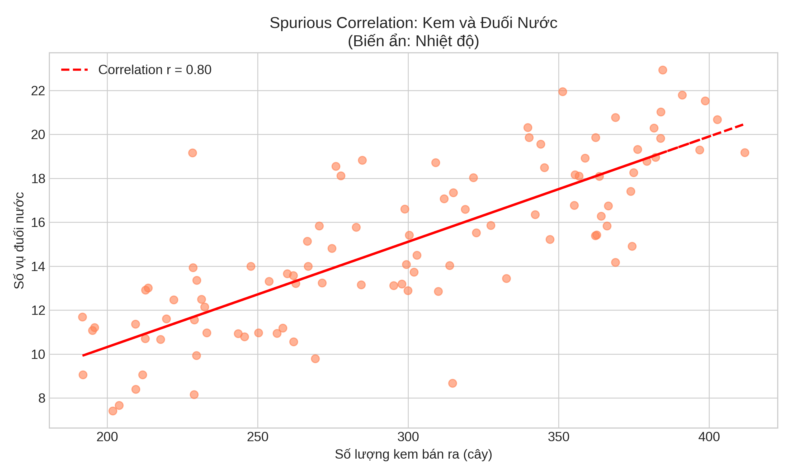
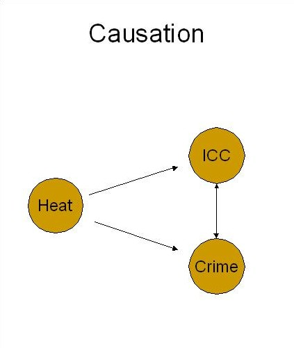

Vào thế kỷ 19, nhà bác học người Anh Francis Galton cẩn thận đo chiều cao của hàng trăm cặp cha–con và nhận ra một quy luật khiến ông kinh ngạc: con trai của những người cha rất cao thường vẫn cao hơn mức trung bình, nhưng lại *thấp hơn cha mình*; ngược lại, con của những người cha rất thấp lại có xu hướng cao hơn cha. Galton gọi xu hướng kéo về giữa đó là *"hồi quy về trung bình" (regression toward the mean)* — và cái tên **hồi quy (regression)** ra đời từ đó!

Ngày nay, **tương quan và hồi quy tuyến tính đơn giản** là viên gạch đầu tiên nối thống kê cổ điển với học máy hiện đại. Bài học này không chỉ giúp bạn vẽ một đường thẳng đi qua đám mây điểm, mà còn trang bị đầy đủ bộ công cụ phản biện dữ liệu: phân biệt **tương quan với nhân quả** (tránh bẫy tương quan giả và biến gây nhiễu), hiểu **Pearson vs. Spearman**, giải mã **$$R^2$$**, và xây dựng khoảng tin cậy lẫn khoảng dự báo.

---

## Bản đồ kiến thức nền: Bốn mảnh ghép cốt lõi của Tương quan và Hồi quy đơn

Trước khi chạy hồi quy trên dữ liệu thật, người làm khoa học dữ liệu cần phân biệt rạch ròi bốn khái niệm thường bị trộn lẫn:

1. **Tương quan tuyến tính (Pearson) vs. Đơn điệu (Spearman):** Hệ số Pearson $$r$$ chỉ đo độ thẳng hàng tuyến tính và rất nhạy với điểm ngoại lệ; Spearman tính Pearson trên *thứ hạng* nên bắt được cả quan hệ cong đơn điệu (như hàm mũ hay logarit). Và quy tắc bất di bất dịch: **tương quan không đồng nghĩa với nhân quả** (hai biến có thể cùng tăng chỉ vì chung một biến gây nhiễu $$Z$$).
2. **Tiêu chuẩn Bình phương Tối thiểu (OLS):** Hồi quy đơn tìm đường thẳng $$\hat{y} = \hat{\beta}_0 + \hat{\beta}_1 x$$ tối thiểu hóa tổng bình phương sai số theo phương thẳng đứng $$\sum (y_i - \hat{y}_i)^2$$. Hệ số góc liên hệ trực tiếp với tương quan qua công thức đẹp mắt: $$\hat{\beta}_1 = r \frac{s_y}{s_x}$$.
3. **Phân rã phương sai & Hệ số xác định $$R^2$$:** Tổng biến thiên của $$Y$$ (TSS) tách gọn thành phần mô hình giải thích được (ESS) cộng phần dư chưa giải thích (RSS). Trong hồi quy đơn, $$R^2 = r^2$$ đúng bằng tỷ lệ phương sai của $$Y$$ được giải thích bởi đường thẳng.
4. **Kiểm tra giả định phần dư (LINE):** Đường hồi quy chỉ đáng tin về mặt suy diễn khi quan hệ là **L**inear (tuyến tính), sai số **I**ndependent (độc lập), **N**ormal (xấp xỉ chuẩn), và **E**qual variance (phương sai đồng nhất).

---

## Hệ Số Tương Quan (Correlation Coefficient)

Trước khi đi vào hồi quy, ta cần nắm vững khái niệm tương quan — đại lượng đo lường mức độ liên hệ tuyến tính giữa hai biến số.

**Hệ số tương quan Pearson (Pearson Correlation Coefficient):**

$$r = \frac{\sum_{i=1}^n (x_i - \bar{x})(y_i - \bar{y})}{\sqrt{\sum_{i=1}^n (x_i - \bar{x})^2} \sqrt{\sum_{i=1}^n (y_i - \bar{y})^2}}$$

**Tính chất:**
- $$-1 \leq r \leq 1$$
- $$r = 1$$: Mối quan hệ tuyến tính dương hoàn hảo.
- $$r = -1$$: Mối quan hệ tuyến tính âm hoàn hảo.
- $$r = 0$$: Không có mối quan hệ tuyến tính (tuy nhiên hai biến vẫn có thể có mối quan hệ phi tuyến).

```python
import numpy as np
import matplotlib.pyplot as plt
from scipy import stats
import seaborn as sns

def visualize_correlation_examples():
    """
    Minh họa correlation với các patterns khác nhau
    """
    np.random.seed(42)
    n = 100
    
    # Tạo các datasets với correlation khác nhau
    datasets = []
    
    # 1. Strong positive
    x1 = np.random.normal(0, 1, n)
    y1 = 2*x1 + np.random.normal(0, 0.5, n)
    datasets.append(('Strong Positive\nr ≈ 0.97', x1, y1))
    
    # 2. Moderate positive
    x2 = np.random.normal(0, 1, n)
    y2 = x2 + np.random.normal(0, 1.5, n)
    datasets.append(('Moderate Positive\nr ≈ 0.55', x2, y2))
    
    # 3. No correlation
    x3 = np.random.normal(0, 1, n)
    y3 = np.random.normal(0, 1, n)
    datasets.append(('No Correlation\nr ≈ 0', x3, y3))
    
    # 4. Negative
    x4 = np.random.normal(0, 1, n)
    y4 = -1.5*x4 + np.random.normal(0, 0.8, n)
    datasets.append(('Negative\nr ≈ -0.88', x4, y4))
    
    # 5. Non-linear (r ≈ 0 nhưng có quan hệ!)
    x5 = np.linspace(-3, 3, n)
    y5 = x5**2 + np.random.normal(0, 1, n)
    datasets.append(('Non-linear\nr ≈ 0 (!)', x5, y5))
    
    # 6. Outlier effect
    x6 = np.random.normal(0, 1, n-1)
    y6 = 0.3*x6 + np.random.normal(0, 1, n-1)
    x6 = np.append(x6, 5)
    y6 = np.append(y6, 5)
    datasets.append(('With Outlier\nr changes!', x6, y6))
    
    # Plot
    fig, axes = plt.subplots(2, 3, figsize=(15, 10))
    axes = axes.flatten()
    
    for i, (title, x, y) in enumerate(datasets):
        r = np.corrcoef(x, y)[0, 1]
        
        axes[i].scatter(x, y, alpha=0.6, s=30)
        
        # Fit line
        z = np.polyfit(x, y, 1)
        p = np.poly1d(z)
        x_line = np.linspace(x.min(), x.max(), 100)
        axes[i].plot(x_line, p(x_line), 'r--', linewidth=2, alpha=0.8)
        
        axes[i].set_xlabel('X')
        axes[i].set_ylabel('Y')
        axes[i].set_title(f'{title}\nActual r = {r:.3f}')
        axes[i].grid(True, alpha=0.3)
    
    plt.tight_layout()
    # plt.show()

# visualize_correlation_examples()
```

## Cạm Bẫy: Tương Quan Giả (Spurious Correlations)

> *"Correlation does not imply causation."* (Tương quan không đồng nghĩa với nhân quả) — nguyên tắc cốt lõi trong thống kê.

Trong cuốn **Naked Statistics**, Charles Wheelan nêu một ví dụ đáng chú ý: tại Mỹ, số lượng bằng tiến sĩ ngành Xã hội học có tương quan rất chặt chẽ với số vụ đuối nước trong hồ bơi. Liệu việc học Xã hội học làm tăng nguy cơ đuối nước, hay ngược lại?

Cả hai giả thuyết đều sai. Thực chất cả hai đại lượng đều tăng theo thời gian dưới tác động của biến ẩn chung là sự gia tăng dân số và phát triển kinh tế. Hiện tượng này được gọi là **tương quan giả (Spurious Correlation)**.

### Biến Gây Nhiễu (Confounding Variable)

Một ví dụ kinh điển khác minh họa vai trò của biến gây nhiễu:
- **Dữ liệu quan sát:** Số lượng kem bán ra tăng đồng thời với số vụ đuối nước tăng (hệ số tương quan dương).
- **Kết luận sai:** Ăn kem gây ra đuối nước.
- **Nguyên nhân thực sự:** **Nhiệt độ (Z)** là biến gây nhiễu. Khi trời nóng, người dân vừa ăn kem nhiều hơn vừa đi bơi nhiều hơn, từ đó làm tăng số vụ đuối nước.


*Dữ liệu cho thấy tương quan dương mạnh (đường đỏ), nhưng không tồn tại quan hệ nhân quả trực tiếp.*


*Sơ đồ minh họa biến ẩn (Nhiệt độ) làm tăng đồng thời cả hai yếu tố.*

```python
def spurious_correlation_demo():
    """
    Minh họa Spurious Correlation: Kem vs Chết đuối
    """
    np.random.seed(42)
    n = 100
    
    # Biến gây nhiễu (Confounding variable): Nhiệt độ
    temperature = np.linspace(20, 40, n) + np.random.normal(0, 2, n)
    
    # Số lượng kem bán ra (phụ thuộc vào nhiệt độ)
    ice_cream_sales = 10 * temperature + np.random.normal(0, 10, n)
    
    # Số vụ chết đuối (cũng phụ thuộc vào nhiệt độ)
    drowning_incidents = 0.5 * temperature + np.random.normal(0, 2, n)
    
    # Tính correlation giữa Kem và Chết đuối
    correlation = np.corrcoef(ice_cream_sales, drowning_incidents)[0, 1]
    
    # Visualization
    fig, ax1 = plt.subplots(figsize=(10, 6))
    
    color = 'tab:blue'
    ax1.set_xlabel('Số lượng kem bán ra (cây)')
    ax1.set_ylabel('Số vụ đuối nước', color=color)
    ax1.scatter(ice_cream_sales, drowning_incidents, color=color, alpha=0.6)
    ax1.tick_params(axis='y', labelcolor=color)
    
    # Fit line
    z = np.polyfit(ice_cream_sales, drowning_incidents, 1)
    p = np.poly1d(z)
    ax1.plot(ice_cream_sales, p(ice_cream_sales), "r--", linewidth=2, label=f'Correlation r = {correlation:.2f}')
    
    plt.title('Spurious Correlation: Kem và Đuối Nước\n(Biến ẩn: Nhiệt độ)')
    plt.legend(loc='upper left')
    plt.grid(True, alpha=0.3)
    # plt.show()
    
    print("Spurious Correlation Demo:")
    print("=" * 60)
    print(f"Correlation(Kem, Đuối nước) = {correlation:.2f}")
    print("Kết luận SAI: Ăn kem nhiều gây đuối nước.")
    print("Sự thật: Nhiệt độ cao làm tăng cả hai!")

# spurious_correlation_demo()
```

### Hệ Số Tương Quan Spearman

Hệ số tương quan Spearman đo lường mức độ liên hệ **đơn điệu (monotonic)** giữa hai biến dựa trên thứ hạng, không đòi hỏi quan hệ đó phải tuyến tính:

```python
def pearson_vs_spearman():
    """
    So sánh Pearson và Spearman correlation
    """
    # Non-linear monotonic relationship
    x = np.linspace(0, 10, 100)
    y = np.exp(0.3*x) + np.random.normal(0, 5, 100)
    
    # Correlations
    pearson_r = np.corrcoef(x, y)[0, 1]
    spearman_r, _ = stats.spearmanr(x, y)
    
    # Plot
    fig, axes = plt.subplots(1, 2, figsize=(14, 5))
    
    # Scatter plot
    axes[0].scatter(x, y, alpha=0.6)
    axes[0].set_xlabel('X')
    axes[0].set_ylabel('Y')
    axes[0].set_title(f'Non-linear Relationship\nPearson r = {pearson_r:.3f}\nSpearman ρ = {spearman_r:.3f}')
    axes[0].grid(True, alpha=0.3)
    
    # Rank plot
    rank_x = stats.rankdata(x)
    rank_y = stats.rankdata(y)
    axes[1].scatter(rank_x, rank_y, alpha=0.6)
    axes[1].set_xlabel('Rank of X')
    axes[1].set_ylabel('Rank of Y')
    axes[1].set_title('Ranks (Spearman uses this)')
    axes[1].grid(True, alpha=0.3)
    
    plt.tight_layout()
    # plt.show()
    
    print("Pearson vs Spearman:")
    print("=" * 60)
    print(f"Pearson r:  {pearson_r:.3f} (measures linear relationship)")
    print(f"Spearman ρ: {spearman_r:.3f} (measures monotonic relationship)")
    print()
    print("✓ Spearman tốt hơn cho non-linear monotonic relationships")

# pearson_vs_spearman()
```

## Hồi Quy Tuyến Tính Đơn Giản (Simple Linear Regression)

**Mô hình:**

$$Y_i = \beta_0 + \beta_1 X_i + \epsilon_i$$

Trong đó:
- $$\beta_0$$: Hệ số chặn (intercept).
- $$\beta_1$$: Hệ số góc (slope).
- $$\epsilon_i \sim N(0, \sigma^2)$$: Sai số ngẫu nhiên (error term).

**Ước lượng bình phương tối thiểu (Least Squares Estimates):**

$$\hat{\beta}_1 = \frac{\sum_{i=1}^n (x_i - \bar{x})(y_i - \bar{y})}{\sum_{i=1}^n (x_i - \bar{x})^2}$$

$$\hat{\beta}_0 = \bar{y} - \hat{\beta}_1 \bar{x}$$

```python
def simple_linear_regression():
    """
    Simple linear regression từ scratch
    """
    # Sinh dữ liệu
    np.random.seed(42)
    n = 50
    true_beta0, true_beta1 = 5, 2
    true_sigma = 3
    
    x = np.random.uniform(0, 10, n)
    y = true_beta0 + true_beta1 * x + np.random.normal(0, true_sigma, n)
    
    # Least squares estimates
    x_mean = x.mean()
    y_mean = y.mean()
    
    beta1_hat = np.sum((x - x_mean) * (y - y_mean)) / np.sum((x - x_mean)**2)
    beta0_hat = y_mean - beta1_hat * x_mean
    
    # Predictions
    y_pred = beta0_hat + beta1_hat * x
    
    # Residuals
    residuals = y - y_pred
    
    # Residual standard error
    rse = np.sqrt(np.sum(residuals**2) / (n - 2))
    
    # Visualize
    fig, axes = plt.subplots(1, 3, figsize=(16, 5))
    
    # 1. Regression line
    axes[0].scatter(x, y, alpha=0.6, s=50, label='Data')
    x_line = np.linspace(x.min(), x.max(), 100)
    y_line = beta0_hat + beta1_hat * x_line
    axes[0].plot(x_line, y_line, 'r-', linewidth=2, 
                label=f'ŷ = {beta0_hat:.2f} + {beta1_hat:.2f}x')
    
    # True line
    y_true = true_beta0 + true_beta1 * x_line
    axes[0].plot(x_line, y_true, 'g--', linewidth=2, alpha=0.7,
                label=f'True: y = {true_beta0} + {true_beta1}x')
    
    axes[0].set_xlabel('X')
    axes[0].set_ylabel('Y')
    axes[0].set_title('Simple Linear Regression')
    axes[0].legend()
    axes[0].grid(True, alpha=0.3)
    
    # 2. Residuals vs Fitted
    axes[1].scatter(y_pred, residuals, alpha=0.6, s=50)
    axes[1].axhline(0, color='red', linestyle='--', linewidth=2)
    axes[1].set_xlabel('Fitted values')
    axes[1].set_ylabel('Residuals')
    axes[1].set_title('Residuals vs Fitted')
    axes[1].grid(True, alpha=0.3)
    
    # 3. Q-Q plot
    stats.probplot(residuals, dist="norm", plot=axes[2])
    axes[2].set_title('Normal Q-Q Plot')
    axes[2].grid(True, alpha=0.3)
    
    plt.tight_layout()
    # plt.show()
    
    print("Simple Linear Regression:")
    print("=" * 60)
    print(f"True model: Y = {true_beta0} + {true_beta1}X + ε, σ = {true_sigma}")
    print()
    print(f"Estimates:")
    print(f"  β₀̂ = {beta0_hat:.4f} (true: {true_beta0})")
    print(f"  β₁̂ = {beta1_hat:.4f} (true: {true_beta1})")
    print(f"  RSE = {rse:.4f} (true σ: {true_sigma})")
    
    return x, y, beta0_hat, beta1_hat

# x, y, beta0_hat, beta1_hat = simple_linear_regression()
```

## Suy Diễn Thống Kê Trong Hồi Quy

### Sai Số Chuẩn và Khoảng Tin Cậy

**Sai số chuẩn (Standard Error) của $$\hat{\beta}_1$$:**

$$SE(\hat{\beta}_1) = \frac{\sigma}{\sqrt{\sum_{i=1}^n (x_i - \bar{x})^2}}$$

Trong thực tế, vì $$\sigma$$ chưa biết nên ta thay bằng sai số chuẩn của phần dư $$\text{RSE} = \sqrt{\frac{\sum_{i=1}^n (y_i - \hat{y}_i)^2}{n - 2}}$$ để tính ước lượng $$\widehat{SE}(\hat{\beta}_1)$$.

**Khoảng tin cậy 95% cho $$\beta_1$$:**

$$\hat{\beta}_1 \pm t_{0.025, n-2} \cdot SE(\hat{\beta}_1)$$

```python
def regression_inference(x, y, beta0_hat, beta1_hat):
    """
    Statistical inference cho regression coefficients
    """
    n = len(x)
    
    # Predictions và residuals
    y_pred = beta0_hat + beta1_hat * x
    residuals = y - y_pred
    
    # Residual standard error
    rse = np.sqrt(np.sum(residuals**2) / (n - 2))
    
    # Standard errors
    x_mean = x.mean()
    se_beta1 = rse / np.sqrt(np.sum((x - x_mean)**2))
    se_beta0 = rse * np.sqrt(1/n + x_mean**2 / np.sum((x - x_mean)**2))
    
    # t-statistics
    t_beta0 = beta0_hat / se_beta0
    t_beta1 = beta1_hat / se_beta1
    
    # p-values (two-tailed)
    p_beta0 = 2 * (1 - stats.t.cdf(abs(t_beta0), df=n-2))
    p_beta1 = 2 * (1 - stats.t.cdf(abs(t_beta1), df=n-2))
    
    # 95% CI
    t_critical = stats.t.ppf(0.975, df=n-2)
    ci_beta0 = (beta0_hat - t_critical*se_beta0, beta0_hat + t_critical*se_beta0)
    ci_beta1 = (beta1_hat - t_critical*se_beta1, beta1_hat + t_critical*se_beta1)
    
    # Verify với sklearn
    from sklearn.linear_model import LinearRegression
    model = LinearRegression()
    model.fit(x.reshape(-1, 1), y)
    
    print("Statistical Inference for Regression:")
    print("=" * 60)
    print(f"{'Coefficient':<15} {'Estimate':<12} {'Std Error':<12} {'t value':<10} {'Pr(>|t|)':<12}")
    print("-" * 60)
    print(f"{'Intercept':<15} {beta0_hat:>11.4f} {se_beta0:>11.4f} {t_beta0:>9.3f} {p_beta0:>11.6f}")
    print(f"{'Slope':<15} {beta1_hat:>11.4f} {se_beta1:>11.4f} {t_beta1:>9.3f} {p_beta1:>11.6f}")
    print()
    print(f"Residual standard error: {rse:.4f} on {n-2} degrees of freedom")
    print()
    print("95% Confidence Intervals:")
    print(f"  β₀: [{ci_beta0[0]:.4f}, {ci_beta0[1]:.4f}]")
    print(f"  β₁: [{ci_beta1[0]:.4f}, {ci_beta1[1]:.4f}]")
    print()
    print("Sklearn verification:")
    print(f"  Intercept: {model.intercept_:.4f}")
    print(f"  Slope: {model.coef_[0]:.4f}")

# regression_inference(x, y, beta0_hat, beta1_hat)
```

## Hệ Số Xác Định $$R^2$$ và Mức Độ Phù Hợp Của Mô Hình

**Hệ số xác định $$R^2$$ (Coefficient of Determination):**

$$R^2 = 1 - \frac{SS_{res}}{SS_{tot}} = 1 - \frac{\sum(y_i - \hat{y}_i)^2}{\sum(y_i - \bar{y})^2}$$

**Ý nghĩa:** Tỷ lệ phương sai của biến phụ thuộc $$Y$$ được mô hình giải thích. Trong hồi quy tuyến tính đơn giản, $$R^2 = r^2$$ (bình phương hệ số tương quan Pearson).

```python
def r_squared_analysis():
    """
    Phân tích R-squared
    """
    # Tạo datasets với R² khác nhau
    np.random.seed(42)
    n = 50
    x = np.linspace(0, 10, n)
    
    datasets = []
    
    # High R²
    y1 = 2*x + 3 + np.random.normal(0, 1, n)
    datasets.append(('High R²', x, y1))
    
    # Medium R²
    y2 = 2*x + 3 + np.random.normal(0, 5, n)
    datasets.append(('Medium R²', x, y2))
    
    # Low R²
    y3 = 2*x + 3 + np.random.normal(0, 15, n)
    datasets.append(('Low R²', x, y3))
    
    # Plot
    fig, axes = plt.subplots(1, 3, figsize=(15, 5))
    
    for i, (title, x_data, y_data) in enumerate(datasets):
        # Fit
        beta1 = np.sum((x_data - x_data.mean()) * (y_data - y_data.mean())) / np.sum((x_data - x_data.mean())**2)
        beta0 = y_data.mean() - beta1 * x_data.mean()
        y_pred = beta0 + beta1 * x_data
        
        # R²
        ss_res = np.sum((y_data - y_pred)**2)
        ss_tot = np.sum((y_data - y_data.mean())**2)
        r_squared = 1 - ss_res/ss_tot
        
        # Correlation
        r = np.corrcoef(x_data, y_data)[0, 1]
        
        # Plot
        axes[i].scatter(x_data, y_data, alpha=0.6, s=30)
        axes[i].plot(x_data, y_pred, 'r-', linewidth=2)
        axes[i].set_xlabel('X')
        axes[i].set_ylabel('Y')
        axes[i].set_title(f'{title}\nR² = {r_squared:.3f}\nr = {r:.3f}\nr² = {r**2:.3f}')
        axes[i].grid(True, alpha=0.3)
    
    plt.tight_layout()
    # plt.show()

# r_squared_analysis()
```

## Các Giả Định Của Hồi Quy Tuyến Tính

1. **Tính tuyến tính (Linearity):** Mối quan hệ giữa $$X$$ và kỳ vọng của $$Y$$ là tuyến tính.
2. **Tính độc lập (Independence):** Các quan sát độc lập với nhau.
3. **Phương sai đồng nhất (Homoscedasticity):** Phương sai của sai số không đổi theo mọi giá trị của $$X$$.
4. **Tính chuẩn (Normality):** Các sai số tuân theo phân phối chuẩn.

```python
def check_assumptions():
    """
    Kiểm tra assumptions của linear regression
    """
    # Tạo dữ liệu vi phạm assumptions
    np.random.seed(42)
    n = 100
    x = np.linspace(0, 10, n)
    
    # 1. Good model
    y_good = 2*x + 5 + np.random.normal(0, 2, n)
    
    # 2. Non-linear
    y_nonlinear = x**2 + np.random.normal(0, 5, n)
    
    # 3. Heteroscedasticity
    y_hetero = 2*x + 5 + np.random.normal(0, 0.5*x, n)
    
    # 4. Non-normal errors
    y_nonnormal = 2*x + 5 + np.random.exponential(2, n) - 2
    
    datasets = [
        ('Good Model', x, y_good),
        ('Non-linear', x, y_nonlinear),
        ('Heteroscedasticity', x, y_hetero),
        ('Non-normal Errors', x, y_nonnormal)
    ]
    
    fig, axes = plt.subplots(4, 2, figsize=(14, 16))
    
    for i, (title, x_data, y_data) in enumerate(datasets):
        # Fit
        beta1 = np.sum((x_data - x_data.mean()) * (y_data - y_data.mean())) / np.sum((x_data - x_data.mean())**2)
        beta0 = y_data.mean() - beta1 * x_data.mean()
        y_pred = beta0 + beta1 * x_data
        residuals = y_data - y_pred
        
        # Scatter plot
        axes[i, 0].scatter(x_data, y_data, alpha=0.6, s=20)
        axes[i, 0].plot(x_data, y_pred, 'r-', linewidth=2)
        axes[i, 0].set_xlabel('X')
        axes[i, 0].set_ylabel('Y')
        axes[i, 0].set_title(f'{title}: Data và Fitted Line')
        axes[i, 0].grid(True, alpha=0.3)
        
        # Residual plot
        axes[i, 1].scatter(y_pred, residuals, alpha=0.6, s=20)
        axes[i, 1].axhline(0, color='red', linestyle='--', linewidth=2)
        axes[i, 1].set_xlabel('Fitted values')
        axes[i, 1].set_ylabel('Residuals')
        axes[i, 1].set_title(f'{title}: Residual Plot')
        axes[i, 1].grid(True, alpha=0.3)
    
    plt.tight_layout()
    # plt.show()
    
    print("Checking Assumptions:")
    print("=" * 60)
    print("1. Good Model: Residuals random, centered at 0 ✓")
    print("2. Non-linear: Residuals show pattern (curved) ✗")
    print("3. Heteroscedasticity: Residuals fan out ✗")
    print("4. Non-normal Errors: Residuals skewed ✗")

# check_assumptions()
```

## Khoảng Dự Báo (Prediction Intervals)

- **Khoảng tin cậy (Confidence Interval) cho $$E[Y|X=x_0]$$:** Phản ánh độ bất định của giá trị kỳ vọng (trung bình) của $$Y$$ tại $$X = x_0$$.
- **Khoảng dự báo (Prediction Interval) cho $$Y|X=x_0$$:** Phản ánh độ bất định của một quan sát riêng lẻ mới tại $$X = x_0$$. Khoảng dự báo luôn rộng hơn khoảng tin cậy vì phải tính thêm cả độ biến thiên ngẫu nhiên của từng quan sát cá biệt.

```python
def prediction_intervals():
    """
    Confidence intervals vs Prediction intervals
    """
    # Fit model
    np.random.seed(42)
    n = 50
    x = np.random.uniform(0, 10, n)
    y = 5 + 2*x + np.random.normal(0, 3, n)
    
    # Estimates
    beta1 = np.sum((x - x.mean()) * (y - y.mean())) / np.sum((x - x.mean())**2)
    beta0 = y.mean() - beta1 * x.mean()
    
    # Predictions
    y_pred = beta0 + beta1 * x
    residuals = y - y_pred
    rse = np.sqrt(np.sum(residuals**2) / (n - 2))
    
    # New x values
    x_new = np.linspace(0, 10, 100)
    y_new = beta0 + beta1 * x_new
    
    # Standard errors
    t_critical = stats.t.ppf(0.975, df=n-2)
    
    # CI for mean response
    se_mean = rse * np.sqrt(1/n + (x_new - x.mean())**2 / np.sum((x - x.mean())**2))
    ci_lower = y_new - t_critical * se_mean
    ci_upper = y_new + t_critical * se_mean
    
    # PI for individual prediction
    se_pred = rse * np.sqrt(1 + 1/n + (x_new - x.mean())**2 / np.sum((x - x.mean())**2))
    pi_lower = y_new - t_critical * se_pred
    pi_upper = y_new + t_critical * se_pred
    
    # Plot
    plt.figure(figsize=(12, 6))
    plt.scatter(x, y, alpha=0.6, s=50, label='Data')
    plt.plot(x_new, y_new, 'r-', linewidth=2, label='Fitted line')
    plt.fill_between(x_new, ci_lower, ci_upper, alpha=0.3, color='blue', 
                     label='95% CI for mean')
    plt.fill_between(x_new, pi_lower, pi_upper, alpha=0.2, color='green',
                     label='95% PI for individual')
    plt.xlabel('X')
    plt.ylabel('Y')
    plt.title('Confidence Interval vs Prediction Interval')
    plt.legend()
    plt.grid(True, alpha=0.3)
    # plt.show()
    
    print("Prediction Intervals:")
    print("=" * 60)
    print("CI for mean: Uncertainty về E[Y|X=x₀]")
    print("PI for individual: Uncertainty về Y|X=x₀")
    print()
    print("⚠️  PI luôn rộng hơn CI vì phải account for:")
    print("    1. Uncertainty trong estimate của mean (như CI)")
    print("    2. Variability của individual observations")

# prediction_intervals()
```

---

### Ví dụ tính tay cầm tay chỉ việc: Khớp đường hồi quy OLS, tính $$r$$ và $$R^2$$ trên 4 điểm dữ liệu

Giả sử ta quan sát 4 sinh viên với số giờ ôn tập $$x_i$$ và điểm bài kiểm tra $$y_i$$:

$$(1, 3),\quad (2, 5),\quad (3, 5),\quad (4, 7).$$

Hãy tính mọi đại lượng bằng tay trong chưa đầy 1 phút:
1. **Trung bình mẫu:** $$\bar{x} = \frac{1+2+3+4}{4} = 2{,}5$$ và $$\bar{y} = \frac{3+5+5+7}{4} = 5{,}0$$.
2. **Lập bảng độ lệch quanh trung bình:**

| $$x_i$$ | $$y_i$$ | $$x_i - \bar{x}$$ | $$y_i - \bar{y}$$ | $$(x_i-\bar{x})^2$$ | $$(x_i-\bar{x})(y_i-\bar{y})$$ | $$(y_i-\bar{y})^2$$ |
| :--- | :--- | :--- | :--- | :--- | :--- | :--- |
| $$1$$ | $$3$$ | $$-1{,}5$$ | $$-2{,}0$$ | $$2{,}25$$ | $$+3{,}0$$ | $$4{,}0$$ |
| $$2$$ | $$5$$ | $$-0{,}5$$ | $$0{,}0$$ | $$0{,}25$$ | $$0{,}0$$ | $$0{,}0$$ |
| $$3$$ | $$5$$ | $$+0{,}5$$ | $$0{,}0$$ | $$0{,}25$$ | $$0{,}0$$ | $$0{,}0$$ |
| $$4$$ | $$7$$ | $$+1{,}5$$ | $$+2{,}0$$ | $$2{,}25$$ | $$+3{,}0$$ | $$4{,}0$$ |
| **Tổng** | — | $$0$$ | $$0$$ | $$S_{xx} = 5{,}0$$ | $$S_{xy} = 6{,}0$$ | $$S_{yy} = 8{,}0$$ |

3. **Tính hệ số hồi quy OLS:**
   $$\hat{\beta}_1 = \frac{S_{xy}}{S_{xx}} = \frac{6{,}0}{5{,}0} = 1{,}2,\qquad \hat{\beta}_0 = \bar{y} - \hat{\beta}_1\bar{x} = 5{,}0 - 1{,}2(2{,}5) = 2{,}0.$$
   Đường hồi quy là $$\hat{y} = 2{,}0 + 1{,}2x$$ (mỗi giờ ôn tăng thêm tương ứng tăng trung bình $$1{,}2$$ điểm).
4. **Tính tương quan $$r$$, $$R^2$$ và kiểm tra phần dư:**
   $$r = \frac{S_{xy}}{\sqrt{S_{xx} S_{yy}}} = \frac{6{,}0}{\sqrt{5{,}0 \times 8{,}0}} = \frac{6}{\sqrt{40}} \approx 0{,}9487, \qquad R^2 = r^2 = \frac{36}{40} = 0{,}90.$$
   Các giá trị dự báo là $$\hat{y} = (3{,}2;\; 4{,}4;\; 5{,}6;\; 6{,}8)$$, phần dư $$e = (-0{,}2;\; +0{,}6;\; -0{,}6;\; +0{,}2)$$ có tổng đúng bằng $$0$$ và tổng bình phương $$\mathrm{RSS} = 0{,}04+0{,}36+0{,}36+0{,}04 = 0{,}80$$ — khớp khít với $$\mathrm{TSS}(1 - R^2) = 8{,}0 \times 0{,}10 = 0{,}80$$!

### Khung giải thích: Bốn bước đọc hiểu một mô hình hồi quy đơn không rơi vào bẫy (nên đọc chậm)

1. **Vẽ biểu đồ phân tán (scatter plot) trước khi tính $$r$$:** Bộ tứ Anscombe nổi tiếng gồm 4 tập dữ liệu có *cùng* $$\bar{x}, \bar{y}, r = 0{,}816$$ và *cùng* đường hồi quy, nhưng hình dáng hoàn toàn khác nhau (một đường cong parabol, một đường thẳng bị một điểm ngoại lệ kéo lệch). Không bao giờ tin $$r$$ hay $$R^2$$ mà chưa nhìn đồ thị!
2. **Đừng nhầm tương quan mạnh với quan hệ nhân quả:** Số kem bán ra và số vụ đuối nước có $$r > 0{,}9$$ chỉ vì cả hai cùng bị chi phối bởi nhiệt độ mùa hè (biến gây nhiễu). Muốn kết luận nhân quả cần thử nghiệm ngẫu nhiên (A/B) hoặc thiết kế suy diễn nhân quả.
3. **Tránh ngoại suy quá xa miền dữ liệu:** Phương trình $$\hat{y} = 2{,}0 + 1{,}2x$$ hợp lý cho $$x \in [1, 4]$$ giờ, nhưng thay $$x = 20$$ giờ sẽ cho $$\hat{y} = 26$$ điểm — vượt khỏi thang điểm 10!
4. **Nhìn biểu đồ phần dư để chẩn đoán:** Nếu phần dư vẽ theo $$\hat{y}$$ tạo hình chữ U (phi tuyến) hoặc hình cái phễu (phương sai thay đổi), mô hình tuyến tính đơn đang bỏ sót cấu trúc quan trọng.

**Kiểm tra nhanh.** Trong ví dụ 4 điểm ở trên, nếu bạn tăng tất cả điểm thi $$y_i$$ lên gấp đôi (nhân 2) còn giữ nguyên số giờ ôn $$x_i$$, thì hệ số góc $$\hat{\beta}_1$$ và hệ số tương quan $$r$$ sẽ thay đổi ra sao?

---

## Video tham khảo

- [The Main Ideas of Fitting a Line to Data (The Main Ideas of Least Squares and Linear Regression.)](https://www.youtube.com/watch?v=PaFPbb66DxQ) — StatQuest with Josh Starmer, tiếng Anh. **Xem trước.** Giải thích trực quan phương pháp bình phương tối thiểu nhằm tìm đường thẳng tối thiểu hóa tổng bình phương phần dư, tương ứng với phần hồi quy đơn của bài.
- [Pearson's Correlation, Clearly Explained!!!](https://www.youtube.com/watch?v=xZ_z8KWkhXE) — StatQuest with Josh Starmer, tiếng Anh. Trình bày hệ số tương quan Pearson trước khi chuyển từ phân tích tương quan sang hồi quy tuyến tính.
- [Correlation vs Causation Explained: Why Patterns Can Mislead Us](https://www.youtube.com/watch?v=ofweqU0Lz4I) — Sprouts, tiếng Anh. Phân biệt tương quan và nhân quả, bổ trợ cho phần tương quan giả được minh họa bằng mô phỏng trong bài.

## Bài Tập Thực Hành

**Bài 1: Tương quan và Nhân quả**
Tạo bộ dữ liệu có biến gây nhiễu (confounding variable):
- Biến $$Z$$ tác động đồng thời lên cả $$X$$ và $$Y$$.
- $$X$$ và $$Y$$ có hệ số tương quan cao nhưng không có quan hệ nhân quả trực tiếp.
- Trực quan hóa dữ liệu và giải thích kết quả.

**Bài 2: Chẩn đoán mô hình hồi quy (Regression Diagnostics)**
Sinh dữ liệu vi phạm từng giả định riêng lẻ:
- Phi tuyến tính (non-linearity).
- Phương sai thay đổi (heteroscedasticity).
- Ngoại lai (outliers).
- Sai số không chuẩn (non-normal errors).
Vẽ các biểu đồ chẩn đoán cho từng trường hợp.

**Bài 3: Bootstrap cho hồi quy**
Cài đặt phương pháp bootstrap để:
- Ước lượng sai số chuẩn (SE) của các hệ số hồi quy.
- Tính khoảng tin cậy (CI) cho các hệ số.
- So sánh với kết quả tính theo công thức giải tích.

**Bài 4: Bộ tứ Anscombe (Anscombe's Quartet)**
Tái tạo Anscombe's Quartet gồm 4 bộ dữ liệu có cùng trung bình của $$X$$ và $$Y$$, cùng đường hồi quy tuyến tính nhưng cấu trúc phân bố hoàn toàn khác nhau, qua đó thấy rõ tầm quan trọng của việc trực quan hóa dữ liệu trước khi mô hình hóa.
